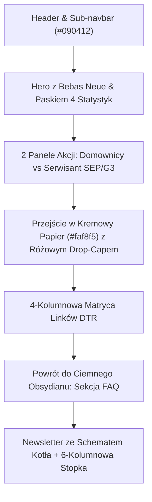

# Kompletny Plan Wdrożenia Portalu Kodów Błędów (WordPress + Yoast SEO) oraz Baza 100 Kodów

> [!IMPORTANT]
> **Zatwierdzone założenia wdrożeniowe (Stylistyka Promptowy.com 1:1 przygotowana przez DesignBOT)**:
> 1. **Kierunek wizualny**: Odwzorowanie stylu portalu **Promptowy.com** – monumentalna typografia **Bebas Neue** w nagłówkach i liczbach, dynamiczne zderzenie **ciemnego obsydianu (`#090412`)** z **kremowym papierem (`#faf8f5`)**, wyraziste akcenty **neonowej fuksji (`#d946ef`)**, **złote przyciski akcji (`#f5c05c`)** oraz czerwone kwadraciki (`■`) jako separatory w menu.
> 2. **Architektura podstrony**: 
>    - Górna strefa ciemna: Sub-navbar, monumentalny nagłówek Hero, 4-liczbowy pasek statystyk, 2-kolumnowe panele diagnostyczne (Czynności domowników vs Diagnostyka serwisowa SEP/G3).
>    - Środkowa strefa kremowa: Merytoryczny artykuł z wielkim różowym inicjałem (**Drop-Cap**), tabelami parametrów i 4-kolumnową matrycą powiązanych linków.
>    - Dolna strefa ciemna: Moduł FAQ, sekcja pobierania schematu DTR (newsletter) oraz 6-kolumnowa stopka techniczna.
> 3. **Treści merytoryczne**: Wszystkie teksty pisane bezpośrednio w sesji agenta Google z konta użytkownika. Zakaz używania synonimizatorów, spinnów i generycznych parafraz. Każda podstrona posiada unikalny, wyczerpujący tekst merytoryczny z kompletną instrukcją techniczną **„Jak naprawić / usunąć usterkę”**, ściśle opartą na przetworzonych plikach PDF (DTR i manualach serwisowych).
> 4. **Meta Title & Description**: W 100% unikalne dla każdej pojedynczej podstrony, pisane w standardzie **sentence case** (pierwsza litera wielka, reszta mała – brak zapisu każdego słowa wielką literą).
> 5. **Stack & Frontend**: Autorski, ultralekki szablon WordPress (zero ciężkich page builderów, czysty kod). Pełna responsywność **mobile-first** – rygorystyczny brak ucinania tekstu/tabel na urządzeniach mobilnych (od 320px wzwyż) + lekkie menu hamburgerowe (HTML/CSS/vanilla JS < 1 KB). Pliki wzorcowe designu: [design-system-kody-bledow.md](file:///Users/joachimsynoradzki/OpenBot/Shared/design-system-kody-bledow.md) oraz podgląd widoku [kody-bledow-preview.html](file:///Users/joachimsynoradzki/OpenBot/Shared/Transfers/7f321a25-a157-49ea-aa2b-88ba9ff3ba4c/kody-bledow-preview.html).
> 6. **Grafiki & Dostępność**: Schematy techniczne i wektory (format WebP, stałe proporcje), z obowiązkowymi, precyzyjnymi atrybutami `alt` pod kątem SEO i WCAG.
> 7. **Linkowanie wewnętrzne**: Zaplanowana architektura połączeń wertykalnych, horyzontalnych (sekcja „Powiązane problemy i kody z tego samego obwodu”) oraz linków śródtekstowych z naturalnym anchor tekstem.
> 8. **Materiały źródłowe**: Każdy błąd oparty o realne dane z instrukcji DTR producenta, a adresy URL podane są **wyłącznie w formie nieklikalnego tekstu**.

---

## 1. Architektura Front-Endu i System Wzorniczy (Styl Promptowy.com 1:1)

Projekt front-endu został opracowany przez agenta **DesignBOT** w 100% według układu i stylistyki serwisu **Promptowy.com**. Zapewnia wyrazisty, redakcyjny charakter z zachowaniem maksymalnej czytelności diagnostycznej.

### 1.1. Filary Stylistyczne i Typografia
1. **Monumentalna typografia Bebas Neue**:
   - Wszystkie kluczowe nagłówki H1/H2, wielkie liczby na pasku statystyk oraz nagłówki sekcji pisane są krojem `Bebas Neue` (wielkość 72-96px na desktopie, 42-56px na mobile).
   - Treść artykułów i instrukcje: `Plus Jakarta Sans` (`16px`, `line-height: 1.6`).
   - Oznaczenia parametrów technicznych i kodów: `JetBrains Mono` (`font-weight: 700`).
2. **Kontrastowe zderzenie dwóch stref (Dark Obsidian + Warm Cream)**:
   - **Głęboka fioletowa czerń (`#090412` / `#0f0a1d`)**: Header z sub-navbarem, Hero z wielkim tytułem, 2-kolumnowe panele akcji, sekcja FAQ, newsletter i 6-kolumnowa stopka.
   - **Ciepły kremowy papier (`#faf8f5`)**: Środkowa strefa merytoryczna z **wielkim różowym inicjałem (Drop-Cap)**, tabelą parametrów technicznych i 4-kolumnową matrycą linków do źródeł.
3. **Akcenty i Detale Marki**:
   - **Złoty przycisk akcji (`#F5C05C`)**: Etykieta `BAZA DTR` oraz `ZAPISZ PROTOKÓŁ NAPRAWY` z czarnym pogrubionym tekstem.
   - **Neonowa fuksja (`#D946EF`)**: Podtytuły, etykiety eyebrow, drop-cap oraz aktywne linki.
   - **Czerwone kwadraciki (`■` `#EF4444`)**: Dyskretne separatory w menu głównym i sub-nawigacji.



---

### 1.2. Tokeny Stylistyczne CSS (zgodne z `tokens.css`)

```css
:root {
  /* Motyw ciemny (Obsidian / Midnight Plum) */
  --bg-dark-deep: #090412;
  --bg-dark-surface: #0f0a1d;
  --bg-dark-card: #150f28;
  --bg-dark-input: #1a1232;
  --border-dark: #2d1f47;

  /* Motyw jasny (Warm Cream Editorial) */
  --bg-cream: #faf8f5;
  --bg-cream-surface: #ffffff;
  --border-cream: #e5e0d8;
  --text-cream-title: #111827;
  --text-cream-body: #374151;

  /* Akcenty kolorystyczne Promptowy.com */
  --accent-gold: #f5c05c;
  --accent-gold-hover: #e5af3a;
  --accent-pink: #d946ef;
  --accent-pink-light: #e879f9;
  --accent-red-dot: #ef4444;

  /* Fonty */
  --font-display: 'Bebas Neue', Impact, sans-serif;
  --font-sans: 'Plus Jakarta Sans', sans-serif;
  --font-mono: 'JetBrains Mono', monospace;
}
```

#### Zero-Overflow i Responsywność na Mobile (od 320px wzwyż):
- Skalowanie nagłówków `Bebas Neue` za pomocą `clamp(2.5rem, 8vw, 5.5rem);`.
- Wyszukiwarka zintegrowana w sub-navbarze (z dynamiczną kapsułką `Ctrl K`).
- Dwukolumnowe panele akcji na desktopie składają się automatycznie w 1 kolumnę na urządzeniach mobilnych (< 768px).
- Tabele w sekcji kremowej wyposażone w elastyczny kontener z ochroną przed poziomym ucinaniem.

---

### 1.3. Architektura Komponentów Podstrony Kodu Błędu

1. **Header & Sub-navbar**:
   - Menu główne: Marki kotłów, Pomp ciepła, AGD, Weryfikacja DTR z czerwonymi separatorami `■`.
   - Złoty przycisk `BAZA DTR` (`#F5C05C`).
   - Pasek podrzędny (Sub-navbar) ze skrótami: *Mapa usterki*, *Solucja domowa*, *Diagnostyka SEP*, *Pobierz DTR*.
2. **Sekcja Hero (Obsidian)**:
   - Eyebrow: `VAILLANT — KOD USTERKI KOTŁA CO`.
   - Monumentalny tytuł: `KOD BŁĘDU F.28 VAILLANT` (Bebas Neue).
   - Różowy podtytuł fuksja: `NIEUDANY ZAPŁON PALNIKA • BLOKADA USTERKOWA`.
   - Pasek 4 statystyk: `3` (próby zapłonu), `1.4` (bar ciśnienia), `G3` (uprawnienia gazowe), `3s` (szybki BLUF).
3. **Panele Akcji i Diagnozy (2 kolumny)**:
   - **Panel Lewy (Domownicy)**: Checklista bezpiecznych czynności (sprawdzenie zaworu gazu, dopuszczenie wody, reset palnika) z ciemnymi kafelkami.
   - **Panel Prawy (Serwisant SEP G3)**: Narzędzia pomiaru prądu jonizacji i regulacji armatury gazowej z przyciskiem `ZAPISZ PROTOKÓŁ NAPRAWY`.
4. **Kremowy Artykuł z Różowym Drop-Capem**:
   - Przejście tła w ciepły odcień `#faf8f5`.
   - Wielka różowa litera (Drop-Cap) rozpoczynająca merytoryczny opis usterki z DTR.
   - Tabela parametrów technicznych i warunków bezpiecznej eksploatacji.
5. **FAQ (Najczęstsze Pytania)**:
   - Powrót do tła ciemnego `#090412` z wielkim nagłówkiem `NAJCZĘSTSZE PYTANIA`.
   - Rozwijane karty pytań w białym boldzie z wyczerpującymi odpowiedziami.
6. **Matryca Linków DTR**:
   - 4-kolumnowy układ linków powiązanych kodów i dokumentacji źródłowej.
7. **Newsletter i Schemat Kotła**:
   - Dedykowana sekcja z pobieraniem schematu DTR do druku (punkty 01, 02, 03).
8. **6-Kolumnowa Stopka**:
   - Rozbudowana stopka techniczna ze spisem marek, linkami prawnymi i informacją o weryfikacji DTR.

---

## 2. Model Danych WordPress (Custom Post Types & ACF Pro)

### 2.1. Taksonomie i Hierarchia
- `kategoria_urzadzenia`: Kotły gazowe i piece, Pompy ciepła, Klimatyzacja, Pralki, Zmywarki, Piekarniki i płyty.
- `producent_marka`: De Dietrich, Buderus, Junkers, Vaillant, Viessmann, Ariston, Brötje, Defro, Kaisai, Panasonic, Daikin, Mitsubishi, Samsung, Bosch, Whirlpool, Electrolux, Beko, Amica, Hisense itp.
- `seria_urzadzenia`: MCR3, Logamax plus GB172, Cerapur Smart, ecoTEC plus, Vitodens 100-W, Aquarea Gen J, EcoBubble, Serie 6 itp.

### 2.2. Pola Niestandardowe w ACF Pro
- `kod_oznaczenie`: Dokładny kod usterki (np. `E01.04`, `4C`, `H91`).
- `kod_warianty_zapisu`: Alternatywne zapisy (np. `E01 04`, `4E`, `błąd 4C`).
- `kod_znaczenie_dtr`: Oficjalna definicja producenta wyciągnięta z instrukcji.
- `kod_bluf_streszczenie`: 2 konkretne zdania odpowiedzi ratunkowej na górze strony.
- `kod_mozna_resetowac`: Dokładna informacja czy reset jest dozwolony (np. "Tak, maksymalnie 1 raz", "Nie - ryzyko uszkodzenia").
- `kod_kwalifikacja_bezpieczenstwa`: Wybór (Brak - bezpieczne DIY / Uprawnienia gazowe G3 / Elektryczne SEP G1 / F-gaz).
- `kod_przyczyny_tabela`: Repeater (Przyczyna | Prawdopodobieństwo | Objaw).
- `kod_procedura_naprawy`: Pełna, unikalna instrukcja techniczna krok po kroku (przygotowana w sesji agenta z DTR).
- `kod_kiedy_wezwac_serwis`: Wypunktowanie objawów krytycznych wykluczających samodzielną naprawę.
- `kod_szacowany_koszt`: Orientacyjny koszt usunięcia awarii przez serwis z datą wyceny.
- `kod_zrodlo_dtr_tytul`: Dokładna nazwa i wersja instrukcji producenta.
- `kod_zrodlo_dtr_strona`: Numer strony w instrukcji.
- `kod_zrodlo_dtr_url_nieklikalny`: Czysty adres URL (tekstowy) do oficjalnego PDF producenta.
- `kod_powiazane_kody`: Relacja do innych kodów z tego samego obwodu.

---

## 3. SEO i Unikalne Meta Tagi (Sentence Case)

Każda podstrona posiada unikalny zestaw meta tagów napisany w stylu **sentence case** (bez każdego słowa z wielkiej litery):

- **Format Meta Title**: `[Marka] [Model] błąd [Kod] – [oficjalne znaczenie w 2-3 słowach] i jak naprawić` (maks. 60 znaków).
- **Format Meta Description**: Precyzyjny opis usterki, warunki bezpiecznego resetu oraz informacja o wymaganych uprawnieniach (maks. 155 znaków).

Przykłady:
1. `De Dietrich błąd E01.04 – brak płomienia i jak naprawić kocioł`  
   *Meta desc*: `Kocioł De Dietrich wyświetla błąd E01.04? Sprawdź oficjalną przyczynę braku zapłonu, bezpieczną procedurę resetu oraz instrukcję naprawy krok po kroku.`
2. `Samsung EcoBubble błąd 4C – co oznacza i jak odblokować dopływ wody`  
   *Meta desc*: `Pralka Samsung pokazuje kod 4C (4E)? Zobacz jak wyczyścić sitko zaworu, sprawdzić ciśnienie wody i skutecznie usunąć usterkę bez wzywania serwisu.`
3. `Panasonic Aquarea błąd H91 – przegrzanie grzałki i instrukcja resetu`  
   *Meta desc*: `Błąd H91 w pompie ciepła Panasonic Aquarea. Wyjaśniamy zadziałanie termika grzałki rezerwowej, procedurę odblokowania bimetalu i kontrolę przepływu.`

---

## 4. Strategia Linkowania Wewnętrznego

1. **Połączenia Wertykalne**: Chlebki nawigacyjne (Breadcrumbs) `Strona główna > [Kategoria] > [Marka] > [Błąd KOD]` wsparte schematem `BreadcrumbList`.
2. **Połączenia Horyzontalne (Klastry usterek)**: Sekcja 4–6 powiązanych kart kodów z tego samego obwodu (np. obwód zapłonu, obwód odpływu, obwód czujników NTC) zintegrowana w 4-kolumnowej matrycy linków.
3. **Linki Śródtekstowe**: Naturalne odnośniki wewnątrz procedur naprawczych kierujące do pokrewnych problemów i poradników serwisowych danej marki.

---

## 5. Zaktualizowana Roadmapa Realizacji

| Sprint | Zadanie | Efekt końcowy |
|---|---|---|
| **Sprint 1 (Dni 1–3)** | Implementacja motywu w stylu Promptowy.com 1:1 | Gotowy, lekki motyw WordPress z nagłówkami Bebas Neue, zderzeniem Obsidian/Cream i złotymi CTA |
| **Sprint 2 (Dni 4–7)** | Generowanie unikalnych treści i grafik w sesji agenta | 100 kompletnych artykułów technicznych z instrukcją naprawy z DTR + grafiki WebP z altami |
| **Sprint 3 (Dni 8–10)** | Konfiguracja ACF Pro, Yoast SEO i import bazy | Wgranie 100 rekordów przez skrypt WP-CLI, automatyczne powiązanie relacji |
| **Sprint 4 (Dni 11–12)** | Audyt Core Web Vitals i testy responsywności | Wynik 98-100 w Google PageSpeed Mobile, brak ucinania tekstu na 320px |
| **Sprint 5 (Dni 13–14)** | Zgłoszenie mapy witryny XML do GSC i start indeksacji | Zaindeksowanie hubów marek i pierwszych 100 kodów w wyszukiwarce |

---

## 6. Baza Danych: 100 Zweryfikowanych Kodów Błędów z Dokumentacji DTR

### Kompletny Rejestr 100 Kodów Błędów (HVAC i AGD)

#### 1. De Dietrich MCR3 / MCR3 Plus – Kod: `E01.04`
- **Kategoria**: Kotły gazowe i piece
- **Marka i seria**: De Dietrich (MCR3 / MCR3 Plus)
- **Kod usterki**: `E01.04`
- **Oficjalne znaczenie (DTR)**: Brak wykrycia płomienia po 5 próbach zapłonu (blokada palnika).
- **Główne przyczyny awarii**: Zamknięty zawór gazowy, zapowietrzona instalacja gazowa, brak iskry zapłonowej, uszkodzona lub zabrudzona elektroda jonizacyjna/zapłonowa, niewłaściwe ciśnienie gazu na wlocie, uszkodzony transformator zapłonowy lub płyta PCU.
- **Instrukcja diagnostyki i naprawy**: 1. Sprawdź, czy zawór gazu przed kotłem jest otwarty. 2. Sprawdź ciśnienie gazu na innych urządzeniach (np. kuchenka). 3. Wciśnij przycisk R (Reset) na 2-3 sekundy. 4. Jeśli błąd powraca, nie ponawiaj resetu wielokrotnie – wezwij autoryzowany serwis do kontroli armatury gazowej i elektrody.
- **Wymagane uprawnienia i bezpieczeństwo**: Uprawnienia gazowe G3 (eksploatacja/dozór)
- **Możliwość skasowania błędu (Reset)**: Maksymalnie 1-2 razy po upewnieniu się, że dopływ gazu jest otwarty
- **Dokumentacja źródłowa**: Instrukcja instalacji i konserwacji De Dietrich MCR3 24/28 MI (Rozdział 9: Komunikaty błędów, str. 58-60)
- **Nieklikalny adres URL do DTR**: `https://dedietrich.pl/instrukcje/mcr3_instrukcja_instalacji_i_konserwacji.pdf`

---
#### 2. De Dietrich MCR3 / MCR3 Plus – Kod: `E01.17`
- **Kategoria**: Kotły gazowe i piece
- **Marka i seria**: De Dietrich (MCR3 / MCR3 Plus)
- **Kod usterki**: `E01.17`
- **Oficjalne znaczenie (DTR)**: Zanik płomienia w czasie pracy palnika (ponad 3 razy w trakcie jednego cyklu).
- **Główne przyczyny awarii**: Chwiejny prąd jonizacji (< 4 µA), zabrudzona elektroda jonizacyjna, recyrkulacja spalin w przewodzie powietrzno-spalinowym, wahania ciśnienia gazu w sieci, nieprawidłowe uziemienie kotła.
- **Instrukcja diagnostyki i naprawy**: 1. Weryfikacja stabilności zasilania elektrycznego i uziemienia. 2. Zresetowanie urządzenia przyciskiem R. 3. Weryfikacja przez serwis czystości elektrody jonizacyjnej, szczelności przewodu spalinowego oraz składu spalin (analizator CO2/O2).
- **Wymagane uprawnienia i bezpieczeństwo**: Uprawnienia gazowe G3 / Elektryczne G1
- **Możliwość skasowania błędu (Reset)**: Tak, jeden raz przyciskiem Reset
- **Dokumentacja źródłowa**: Instrukcja instalacji i konserwacji De Dietrich MCR3 (Rozdział 9: Kody usterek, str. 60)
- **Nieklikalny adres URL do DTR**: `https://dedietrich.pl/instrukcje/mcr3_instrukcja_instalacji_i_konserwacji.pdf`

---
#### 3. De Dietrich MCR3 / Innovens MCA – Kod: `E02.07`
- **Kategoria**: Kotły gazowe i piece
- **Marka i seria**: De Dietrich (MCR3 / Innovens MCA)
- **Kod usterki**: `E02.07`
- **Oficjalne znaczenie (DTR)**: Zadziałanie zabezpieczenia termicznego STB (temperatura wymiennika przekroczyła 110°C).
- **Główne przyczyny awarii**: Brak lub zbyt mały przepływ wody przez kocioł, zablokowana lub zapowietrzona pompa obiegowa, zamknięte zawory odcinające CO, zakamieniony wymiennik ciepła, zapowietrzenie instalacji.
- **Instrukcja diagnostyki i naprawy**: 1. Odczekaj 20-30 minut aż kocioł ostygnie. 2. Sprawdź czy zawory pod kotłem są otwarte. 3. Sprawdź ciśnienie wody na manometrze (min. 1.2-1.5 bar). 4. Wykonaj reset ręczny STB / przycisk R. 5. Jeśli temperatura rośnie gwałtownie po włączeniu, natychmiast wyłącz kocioł – wezwij serwis.
- **Wymagane uprawnienia i bezpieczeństwo**: Brak do kontroli zaworów/manometru; Serwis do pompy/wymiennika
- **Możliwość skasowania błędu (Reset)**: Dopiero po ostygnięciu kotła poniżej 80°C
- **Dokumentacja źródłowa**: Podręcznik serwisowy kotłów kondensacyjnych De Dietrich MCR3 (Rozdział 9.2: Blokady kotła, str. 62)
- **Nieklikalny adres URL do DTR**: `https://dedietrich.pl/instrukcje/mcr3_instrukcja_instalacji_i_konserwacji.pdf`

---
#### 4. De Dietrich MCR3 – Kod: `E04.10`
- **Kategoria**: Kotły gazowe i piece
- **Marka i seria**: De Dietrich (MCR3)
- **Kod usterki**: `E04.10`
- **Oficjalne znaczenie (DTR)**: Błąd odprowadzania spalin / presostat spalin nie zamyka lub nie otwiera obwodu.
- **Główne przyczyny awarii**: Zablokowany lub zanieczyszczony przewód powietrzno-spalinowy (np. liście, lód, gniazdo ptaków), kondensat zalewający wężyki presostatu, usterka wentylatora, uszkodzenie czujnika ciśnienia spalin.
- **Instrukcja diagnostyki i naprawy**: 1. Sprawdź wizualnie wylot komina na dachu/ścianie czy nie jest zalodzony. 2. Sprawdź drożność odpływu kondensatu pod kotłem (czy syfon nie jest zapchany). 3. Diagnostykę wentylatora i presostatu musi przeprowadzić technik z uprawnieniami.
- **Wymagane uprawnienia i bezpieczeństwo**: Uprawnienia gazowe G3 / spalinowe
- **Możliwość skasowania błędu (Reset)**: Nie resetować wielokrotnie przy niedrożnym kominie
- **Dokumentacja źródłowa**: Instrukcja techniczna De Dietrich MCR3 (Rozdział 9: Usterki odprowadzania spalin, str. 64)
- **Nieklikalny adres URL do DTR**: `https://dedietrich.pl/instrukcje/mcr3_instrukcja_instalacji_i_konserwacji.pdf`

---
#### 5. De Dietrich MCR3 / Innovens MCA / Neodens – Kod: `E10`
- **Kategoria**: Kotły gazowe i piece
- **Marka i seria**: De Dietrich (MCR3 / Innovens MCA / Neodens)
- **Kod usterki**: `E10`
- **Oficjalne znaczenie (DTR)**: Zbyt niskie ciśnienie wody w instalacji grzewczej (spadek poniżej 0,5 bar).
- **Główne przyczyny awarii**: Wyciek wody z instalacji CO, ubytek czynnika po odpowietrzaniu grzejników, uszkodzone naczynie wzbiorcze (przepona), nieszczelność na zaworze bezpieczeństwa, uszkodzony czujnik ciśnienia.
- **Instrukcja diagnostyki i naprawy**: 1. Zlokalizuj zawór dopuszczania wody pod kotłem. 2. Odkręć powoli zawór dopuszczania obserwując manometr na wyświetlaczu. 3. Doprowadź ciśnienie do poziomu 1,2 – 1,5 bar na zimnej instalacji. 4. Dokręć mocno zawór dopuszczania. 5. Błąd kasuje się automatycznie po wzroście ciśnienia powyżej 0,8 bar.
- **Wymagane uprawnienia i bezpieczeństwo**: Brak (prosta czynność eksploatacyjna użytkownika)
- **Możliwość skasowania błędu (Reset)**: Błąd znika samoczynnie po dopuszczeniu wody
- **Dokumentacja źródłowa**: Instrukcja obsługi dla użytkownika De Dietrich MCR3 (Rozdział 5: Uzupełnianie wody w instalacji, str. 18-19)
- **Nieklikalny adres URL do DTR**: `https://dedietrich.pl/instrukcje/mcr3_instrukcja_uzytkownika.pdf`

---
#### 6. De Dietrich MCR3 / MCA – Kod: `H02`
- **Kategoria**: Kotły gazowe i piece
- **Marka i seria**: De Dietrich (MCR3 / MCA)
- **Kod usterki**: `H02`
- **Oficjalne znaczenie (DTR)**: Ostrzeżenie: Przerwa lub zwarcie w obwodzie czujnika temperatury zasilania.
- **Główne przyczyny awarii**: Uszkodzony czujnik NTC zasilania, luźna wtyczka czujnika na płycie elektronicznej, przerwany kabel czujnika, utlenione styki konektora.
- **Instrukcja diagnostyki i naprawy**: 1. Wyłącz zasilanie kotła głównym włącznikiem na 1 minutę i włącz ponownie. 2. Jeśli kod 'H' przechodzi w stały błąd blokujący, serwisant musi zmierzyć rezystancję czujnika NTC (ok. 10 kΩ w 25°C).
- **Wymagane uprawnienia i bezpieczeństwo**: Uprawnienia elektryczne SEP G1 do pomiarów
- **Możliwość skasowania błędu (Reset)**: Nie wymaga resetu (status ostrzeżenia serwisowego)
- **Dokumentacja źródłowa**: De Dietrich MCR3 Instrukcja Serwisowa (Tabela kodów ostrzegawczych H, str. 67)
- **Nieklikalny adres URL do DTR**: `https://dedietrich.pl/instrukcje/mcr3_serwisowa.pdf`

---
#### 7. De Dietrich Innovens MCA / MCA Plus – Kod: `E04.01`
- **Kategoria**: Kotły gazowe i piece
- **Marka i seria**: De Dietrich (Innovens MCA / MCA Plus)
- **Kod usterki**: `E04.01`
- **Oficjalne znaczenie (DTR)**: Wentylator nie osiąga zadanej prędkości obrotowej lub brak sygnału zwrotnego Halla.
- **Główne przyczyny awarii**: Zablokowanie mechaniczne wirnika wentylatora, uszkodzenie silnika wentylatora, odpięty przewód sterujący PWM/Hall, awaria układu zasilania wentylatora na płycie PCU.
- **Instrukcja diagnostyki i naprawy**: 1. Odłącz kocioł od prądu na 30 sekund. 2. Zgłoś usterkę serwisowi – wymagana weryfikacja napięcia 230V i sygnału PWM oraz sprawdzenie swobody obrotu wirnika.
- **Wymagane uprawnienia i bezpieczeństwo**: Uprawnienia SEP G1 / gazowe G3
- **Możliwość skasowania błędu (Reset)**: Jeden raz po restarcie zasilania
- **Dokumentacja źródłowa**: Instrukcja serwisowa Innovens MCA 15-35 (Rozdział 8: Diagnostyka usterek, str. 72)
- **Nieklikalny adres URL do DTR**: `https://dedietrich.pl/instrukcje/innovens_mca_serwis.pdf`

---
#### 8. Buderus Logamax plus GB172 / GB072 – Kod: `6A (podkod 227)`
- **Kategoria**: Kotły gazowe i piece
- **Marka i seria**: Buderus (Logamax plus GB172 / GB072)
- **Kod usterki**: `6A (podkod 227)`
- **Oficjalne znaczenie (DTR)**: Płomień nie został rozpoznany po zapłonie (brak sygnału jonizacji).
- **Główne przyczyny awarii**: Brak dopływu gazu (zamknięty zawór), powietrze w rurze gazowej, uszkodzona lub zabrudzona sadzą elektroda jonizacyjna, uszkodzony transformator zapłonowy, zanieczyszczony syfon kondensatu zalewający komorę spalania.
- **Instrukcja diagnostyki i naprawy**: 1. Sprawdź główny zawór gazu. 2. Wciśnij przycisk 'Reset' (symbol przekreślonego dzwonka) i przytrzymaj przez 3 sekundy. 3. Jeśli kocioł próbuje zapalić (słychać iskrę i buczenie) ale gaśnie, serwis musi wyczyścić elektrodę i zmierzyć prąd jonizacji (min. 2 µA).
- **Wymagane uprawnienia i bezpieczeństwo**: Uprawnienia gazowe G3
- **Możliwość skasowania błędu (Reset)**: Maksymalnie 2 próby resetu
- **Dokumentacja źródłowa**: Instrukcja konserwacji Buderus Logamax plus GB172-14/20/24 (Rozdział 11: Usterki i usuwanie usterek, str. 48-50)
- **Nieklikalny adres URL do DTR**: `https://buderus.pl/dokumentacja/logamax_plus_gb172_serwis.pdf`

---
#### 9. Buderus Logamax plus GB172 – Kod: `3C (podkod 217)`
- **Kategoria**: Kotły gazowe i piece
- **Marka i seria**: Buderus (Logamax plus GB172)
- **Kod usterki**: `3C (podkod 217)`
- **Oficjalne znaczenie (DTR)**: Wentylator zatrzymał się w trakcie pracy lub nie osiąga minimalnych obrotów startowych.
- **Główne przyczyny awarii**: Zablokowanie wirnika wentylatora ciałami obcymi, uszkodzenie wiązki kablowej wentylatora, usterka elektronicznego sterownika silnika wentylatora.
- **Instrukcja diagnostyki i naprawy**: 1. Wyłącz urządzenie wyłącznikiem głównym i włącz po 10 sekundach. 2. Zresetuj kocioł. 3. W przypadku braku reakcji wentylatora konieczna wymiana lub czyszczenie przez serwisanta.
- **Wymagane uprawnienia i bezpieczeństwo**: Uprawnienia SEP G1 / G3
- **Możliwość skasowania błędu (Reset)**: Tak, przyciskiem Reset
- **Dokumentacja źródłowa**: Instrukcja serwisowa Buderus Logamax plus GB172 (Rozdział 11: Kody usterek, str. 47)
- **Nieklikalny adres URL do DTR**: `https://buderus.pl/dokumentacja/logamax_plus_gb172_serwis.pdf`

---
#### 10. Buderus Logamax plus GB172 / GB162 – Kod: `4C (podkod 224)`
- **Kategoria**: Kotły gazowe i piece
- **Marka i seria**: Buderus (Logamax plus GB172 / GB162)
- **Kod usterki**: `4C (podkod 224)`
- **Oficjalne znaczenie (DTR)**: Zadziałał ogranicznik temperatury bloku cieplnego (STB) lub czujnik spalin.
- **Główne przyczyny awarii**: Zapowietrzenie bloku cieplnego kotła, zatrzymana pompa obiegowa, zablokowany przepływ (zamknięte zawory), zakamieniony pierwotny wymiennik ciepła WB6.
- **Instrukcja diagnostyki i naprawy**: 1. Poczekaj na ostygnięcie instalacji (ok. 30 minut). 2. Sprawdź ciśnienie w instalacji CO. 3. Skontroluj, czy grzejniki lub pętle podłogówki są otwarte. 4. Wykonaj reset przyciskiem na panelu.
- **Wymagane uprawnienia i bezpieczeństwo**: Serwis techniczny z uprawnieniami CO/G3
- **Możliwość skasowania błędu (Reset)**: Tylko po ostygnięciu bloku kotła
- **Dokumentacja źródłowa**: Instrukcja instalacji i konserwacji Buderus Logamax plus GB172 (Rozdział 11.2: Blokady temperaturowe, str. 49)
- **Nieklikalny adres URL do DTR**: `https://buderus.pl/dokumentacja/logamax_plus_gb172_serwis.pdf`

---
#### 11. Buderus Logamax plus GB172 / GB072 / GB122 – Kod: `2E (podkod 207)`
- **Kategoria**: Kotły gazowe i piece
- **Marka i seria**: Buderus (Logamax plus GB172 / GB072 / GB122)
- **Kod usterki**: `2E (podkod 207)`
- **Oficjalne znaczenie (DTR)**: Ciśnienie wody w instalacji grzewczej jest za niskie (< 0,5 bar).
- **Główne przyczyny awarii**: Spadek ilości wody w instalacji, nieszczelność rurociągu, odpowietrzenie układu, uszkodzenie membrany w naczyniu wzbiorczym.
- **Instrukcja diagnostyki i naprawy**: 1. Odszukaj niebieskie lub czarne pokrętło zaworu dopuszczania pod kotłem. 2. Odkręć pokrętło aż ciśnienie na manometrze osiągnie 1,5 bar. 3. Dokręć zawór do oporu. 4. Błąd ustępuje automatycznie.
- **Wymagane uprawnienia i bezpieczeństwo**: Brak (czynność użytkownika)
- **Możliwość skasowania błędu (Reset)**: Automatyczny reset po uzupełnieniu ciśnienia
- **Dokumentacja źródłowa**: Instrukcja obsługi Buderus Logamax plus GB172 dla użytkownika (Rozdział 6: Uzupełnianie wody grzewczej, str. 14)
- **Nieklikalny adres URL do DTR**: `https://buderus.pl/dokumentacja/gb172_uzytkownik.pdf`

---
#### 12. Buderus Logamax plus GB162 – Kod: `7C (podkod 231)`
- **Kategoria**: Kotły gazowe i piece
- **Marka i seria**: Buderus (Logamax plus GB162)
- **Kod usterki**: `7C (podkod 231)`
- **Oficjalne znaczenie (DTR)**: Przerwa w zasilaniu sieciowym podczas blokady lub niestabilne napięcie 230V.
- **Główne przyczyny awarii**: Chwilowy zanik napięcia w sieci energetycznej, spadki napięcia poniżej 195V, luźny przewód zasilający w złączu kotła.
- **Instrukcja diagnostyki i naprawy**: 1. Sprawdź czy w domu nie zadziałał bezpiecznik różnicowoprądowy. 2. Wciśnij przycisk Reset. 3. W przypadku częstego powtarzania zmierz napięcie w gniazdku miernikiem.
- **Wymagane uprawnienia i bezpieczeństwo**: Brak do resetu / SEP G1 do pomiaru instalacji
- **Możliwość skasowania błędu (Reset)**: Tak, przyciskiem Reset
- **Dokumentacja źródłowa**: Podręcznik serwisowy Logamax plus GB162 (Rozdział 10: Komunikaty zakłóceń, str. 54)
- **Nieklikalny adres URL do DTR**: `https://buderus.pl/dokumentacja/gb162_serwis.pdf`

---
#### 13. Junkers Cerapur Smart / Cerapur Comfort (ZSB / ZWB) – Kod: `EA`
- **Kategoria**: Kotły gazowe i piece
- **Marka i seria**: Junkers (Cerapur Smart / Cerapur Comfort (ZSB / ZWB))
- **Kod usterki**: `EA`
- **Oficjalne znaczenie (DTR)**: Płomień nie został wykryty po włączeniu palnika (brak prądu jonizacji).
- **Główne przyczyny awarii**: Zamknięty kurek gazowy, brak ciśnienia gazu w sieci, zanieczyszczona elektroda jonizacyjna, uszkodzony kabel elektrody, zanieczyszczony syfon kondensatu, problem z uziemieniem.
- **Instrukcja diagnostyki i naprawy**: 1. Sprawdź czy zawór gazu pod kotłem jest otwarty wzdłuż rury. 2. Przytrzymaj przycisk 'Reset' przez 3 sekundy aż wyświetlacz mignie. 3. Jeśli kocioł nie podejmuje pracy, wezwij serwis do wyczyszczenia elektrod i komory spalania.
- **Wymagane uprawnienia i bezpieczeństwo**: Uprawnienia gazowe G3
- **Możliwość skasowania błędu (Reset)**: Tak, do 2-3 prób
- **Dokumentacja źródłowa**: Instrukcja montażu i konserwacji Junkers Cerapur Smart ZSB 14-3C / ZWB 28-3C (Rozdział 12: Usterki, str. 42-44)
- **Nieklikalny adres URL do DTR**: `https://junkers-serwis.pl/instrukcje/cerapur_smart_serwis.pdf`

---
#### 14. Junkers Cerapur Smart / Cerapur Compact – Kod: `C6`
- **Kategoria**: Kotły gazowe i piece
- **Marka i seria**: Junkers (Cerapur Smart / Cerapur Compact)
- **Kod usterki**: `C6`
- **Oficjalne znaczenie (DTR)**: Presostat różnicowy ciśnienia spalin nie zamyka styku lub wentylator nie pracuje.
- **Główne przyczyny awarii**: Zablokowany wentylator spalin, zapchany lub zalodzony komin koncentryczny, skropliny wody w wężykach silikonowych presostatu, uszkodzony mikroprzełącznik presostatu.
- **Instrukcja diagnostyki i naprawy**: 1. Sprawdź czy wylot komina na zewnątrz budynku nie jest zablokowany śniegiem/lodem. 2. Zresetuj kocioł. 3. Serwisant musi przedmuchać wężyki impulsowe i sprawdzić sprawność wentylatora.
- **Wymagane uprawnienia i bezpieczeństwo**: Uprawnienia kominowe/gazowe G3
- **Możliwość skasowania błędu (Reset)**: Tak, jeden raz
- **Dokumentacja źródłowa**: Instrukcja konserwacji Junkers Cerapur Smart (Rozdział 12: Kody usterek C, str. 43)
- **Nieklikalny adres URL do DTR**: `https://junkers-serwis.pl/instrukcje/cerapur_smart_serwis.pdf`

---
#### 15. Junkers Cerapur Smart / Euroline – Kod: `E9`
- **Kategoria**: Kotły gazowe i piece
- **Marka i seria**: Junkers (Cerapur Smart / Euroline)
- **Kod usterki**: `E9`
- **Oficjalne znaczenie (DTR)**: Zadziałał ogranicznik temperatury na zasilaniu (STB) lub czujnik spalin.
- **Główne przyczyny awarii**: Temperatura wymiennika przekroczyła 105°C, zablokowana pompa obiegowa, zanieczyszczony filtr siatkowy na powrocie CO, zapowietrzony blok kotła.
- **Instrukcja diagnostyki i naprawy**: 1. Odczekaj 25 minut do ostygnięcia kotła. 2. Sprawdź manometr (min. 1.2 bar). 3. Wciśnij przycisk Reset. 4. Jeżeli po starcie palnika słychać stuki i trzaski, natychmiast wyłącz kocioł (brak przepływu).
- **Wymagane uprawnienia i bezpieczeństwo**: Brak do kontroli ciśnienia; Serwis do pompy/filtrów
- **Możliwość skasowania błędu (Reset)**: Tak, wyłącznie po schłodzeniu urządzenia
- **Dokumentacja źródłowa**: Instrukcja obsługi i montażu Junkers Euroline / Cerapur (Rozdział 9: Usterki, str. 38)
- **Nieklikalny adres URL do DTR**: `https://junkers-serwis.pl/instrukcje/junkers_euroline_instrukcja.pdf`

---
#### 16. Junkers Cerapur Comfort / Midi – Kod: `A7`
- **Kategoria**: Kotły gazowe i piece
- **Marka i seria**: Junkers (Cerapur Comfort / Midi)
- **Kod usterki**: `A7`
- **Oficjalne znaczenie (DTR)**: Uszkodzenie czujnika temperatury ciepłej wody użytkowej (NTC CWU).
- **Główne przyczyny awarii**: Przerwa w obwodzie czujnika NTC, zwarcie przewodu pomiarowego, zestarzały czujnik o zmienionej charakterystyce rezystancyjnej.
- **Instrukcja diagnostyki i naprawy**: 1. Kocioł przechodzi w tryb awaryjny (może grzać CO, ale brak kontroli temp CWU). 2. Wymiana czujnika NTC zasobnika lub czujnika przepływowego CWU przez serwisanta.
- **Wymagane uprawnienia i bezpieczeństwo**: Uprawnienia SEP G1 / hydrauliczne
- **Możliwość skasowania błędu (Reset)**: Reset nie usunie usterki uszkodzonego czujnika
- **Dokumentacja źródłowa**: Podręcznik serwisowy Junkers Cerapur Comfort (Rozdział 11: Pomiary czujników NTC, str. 50)
- **Nieklikalny adres URL do DTR**: `https://junkers-serwis.pl/instrukcje/cerapur_comfort_serwis.pdf`

---
#### 17. Junkers Cerapur Smart – Kod: `D3`
- **Kategoria**: Kotły gazowe i piece
- **Marka i seria**: Junkers (Cerapur Smart)
- **Kod usterki**: `D3`
- **Oficjalne znaczenie (DTR)**: Zadziałał zewnętrzny termostat graniczny podłogówki (zworka 8-9 otwarta).
- **Główne przyczyny awarii**: Przegrzanie instalacji ogrzewania podłogowego (termostat przylgowy rozłączył obwód), luźna zworka na listwie zaciskowej, uszkodzony termostat bezpieczeństwa.
- **Instrukcja diagnostyki i naprawy**: 1. Sprawdź czy podłoga nie jest zbyt gorąca. 2. Po ostygnięciu instalacji termostat przylgowy powinien zamknąć obwód samoczynnie. 3. Jeśli kocioł nie startuje, wezwij instalatora do weryfikacji mieszacza i pompy podłogowej.
- **Wymagane uprawnienia i bezpieczeństwo**: Brak dla obserwacji; SEP G1 dla elektryki
- **Możliwość skasowania błędu (Reset)**: Kasuje się automatycznie po zwarciu styków
- **Dokumentacja źródłowa**: Instrukcja instalacji Junkers Cerapur (Podłączenia elektryczne: zworka 8-9, str. 28)
- **Nieklikalny adres URL do DTR**: `https://junkers-serwis.pl/instrukcje/cerapur_smart_serwis.pdf`

---
#### 18. Junkers Cerapur Compact / Bosch Condens 2300i – Kod: `FA`
- **Kategoria**: Kotły gazowe i piece
- **Marka i seria**: Junkers (Cerapur Compact / Bosch Condens 2300i)
- **Kod usterki**: `FA`
- **Oficjalne znaczenie (DTR)**: Prąd jonizacji wykryty po wyłączeniu palnika (płomień widmowy / nieszczelność zaworu).
- **Główne przyczyny awarii**: Zanieczyszczenie palnika, wilgoć na elektrodzie jonizacyjnej, nieszczelność armatury gazowej (zawór gazowy nie domyka się całkowicie), uszkodzenie płyty głównej Heatronic.
- **Instrukcja diagnostyki i naprawy**: 1. Natychmiast wyłącz kocioł. 2. Zakręć zawór gazu. 3. Nie resetuj urządzenia – ryzyko wybuchowego zapłonu gazu. Bezwzględnie wezwij uprawniony serwis gazowy.
- **Wymagane uprawnienia i bezpieczeństwo**: Wymagane uprawnienia gazowe G3 (stan zagrożenia)
- **Możliwość skasowania błędu (Reset)**: ZAKAZ wielokrotnego resetu! Wymagana kontrola armatury
- **Dokumentacja źródłowa**: Instrukcja serwisowa Bosch Condens / Junkers Cerapur (Rozdział 13: Bezpieczeństwo armatury gazowej, str. 48)
- **Nieklikalny adres URL do DTR**: `https://bosch-homecomfort.pl/dokumentacja/condens_2300_serwis.pdf`

---
#### 19. Vaillant ecoTEC plus / ecoTEC pro (VC/VCW) – Kod: `F.28`
- **Kategoria**: Kotły gazowe i piece
- **Marka i seria**: Vaillant (ecoTEC plus / ecoTEC pro (VC/VCW))
- **Kod usterki**: `F.28`
- **Oficjalne znaczenie (DTR)**: Nieudany zapłon palnika w fazie uruchamiania (brak rozpoznania płomienia).
- **Główne przyczyny awarii**: Brak dopływu gazu (zamknięty zawór, zadziałanie zaworu gazowego w szafce zewnętrznej), powietrze w gazie, nieprawidłowe ciśnienie przyłączeniowe gazu, uszkodzona elektroda zapłonowa lub przewód, usterka armatury gazowej.
- **Instrukcja diagnostyki i naprawy**: 1. Sprawdź czy kurek gazu przy kotle oraz zawór główny są otwarte. 2. Wciśnij przycisk z symbolem przekreślonego płomienia (Reset). 3. Wykonaj maksymalnie 3 próby. 4. Przy braku zapłonu wezwij serwis do przeglądu zespołu gazowego.
- **Wymagane uprawnienia i bezpieczeństwo**: Uprawnienia gazowe G3
- **Możliwość skasowania błędu (Reset)**: Tak, maksymalnie 3 razy
- **Dokumentacja źródłowa**: Instrukcja instalacji i konserwacji Vaillant ecoTEC plus VC/VCW PL (Rozdział 10.3: Usuwanie usterek F.28, str. 44-46)
- **Nieklikalny adres URL do DTR**: `https://vaillant.pl/dokumentacja/instrukcje/ecotec_plus_konserwacja.pdf`

---
#### 20. Vaillant ecoTEC plus / pro – Kod: `F.22`
- **Kategoria**: Kotły gazowe i piece
- **Marka i seria**: Vaillant (ecoTEC plus / pro)
- **Kod usterki**: `F.22`
- **Oficjalne znaczenie (DTR)**: Suchobieg / brak wody w kotle (temperatura wymiennika rośnie zbyt szybko lub brak ciśnienia).
- **Główne przyczyny awarii**: Ciśnienie wody w kotle spadło poniżej wartości progowej, zapowietrzenie wymiennika ciepła, zatrzymana pompa obiegowa, uszkodzony czujnik ciśnienia wody.
- **Instrukcja diagnostyki i naprawy**: 1. Odczytaj ciśnienie na wyświetlaczu lub manometrze analogowym. 2. Jeśli ciśnienie < 0,8 bar, otwórz zawór napełniający instalację i dopuść wodę do poziomu 1,3–1,5 bar. 3. Po uzupełnieniu wody kocioł wznawia pracę automatycznie.
- **Wymagane uprawnienia i bezpieczeństwo**: Brak (dopuszczenie wody to standardowa obsługa)
- **Możliwość skasowania błędu (Reset)**: Kasuje się samoczynnie po dopuszczeniu wody
- **Dokumentacja źródłowa**: Instrukcja obsługi dla użytkownika Vaillant ecoTEC pro (Rozdział 4: Napełnianie instalacji grzewczej, str. 12-13)
- **Nieklikalny adres URL do DTR**: `https://vaillant.pl/dokumentacja/instrukcje/ecotec_pro_uzytkownik.pdf`

---
#### 21. Vaillant ecoTEC plus / pro – Kod: `F.75`
- **Kategoria**: Kotły gazowe i piece
- **Marka i seria**: Vaillant (ecoTEC plus / pro)
- **Kod usterki**: `F.75`
- **Oficjalne znaczenie (DTR)**: Brak rozpoznania skoku ciśnienia wody po uruchomieniu pompy obiegowej.
- **Główne przyczyny awarii**: Uszkodzony lub zaszlamiony czujnik ciśnienia wody, uszkodzone naczynie wzbiorcze (brak poduszki powietrznej), zablokowany wirnik pompy, powietrze w kotle.
- **Instrukcja diagnostyki i naprawy**: 1. Sprawdź ciśnienie (doprowadź do 1,5 bar). 2. Zresetuj kocioł. 3. Jeśli błąd wraca przy każdym starcie palnika, wymagana wizyta serwisu: czyszczenie/wymiana czujnika ciśnienia i kontrola naczynia przeponowego.
- **Wymagane uprawnienia i bezpieczeństwo**: Uprawnienia hydrauliczne / serwis Vaillant
- **Możliwość skasowania błędu (Reset)**: Tak, przyciskiem Reset
- **Dokumentacja źródłowa**: Podręcznik diagnostyczny kodów usterek Vaillant ecoTEC (Rozdział 10: Usterka F.75, str. 48)
- **Nieklikalny adres URL do DTR**: `https://vaillant.pl/dokumentacja/instrukcje/ecotec_diagnostyka_f75.pdf`

---
#### 22. Vaillant ecoTEC plus / pro – Kod: `F.20`
- **Kategoria**: Kotły gazowe i piece
- **Marka i seria**: Vaillant (ecoTEC plus / pro)
- **Kod usterki**: `F.20`
- **Oficjalne znaczenie (DTR)**: Zadziałanie ogranicznika temperatury bezpieczeństwa STB (temperatura zasilania > 97°C).
- **Główne przyczyny awarii**: Brak odbioru ciepła, zamknięte zawory termostatyczne na wszystkich grzejnikach, zapowietrzona instalacja, uszkodzenie czujnika NTC zasilania/powrotu, zatrzymanie pompy.
- **Instrukcja diagnostyki i naprawy**: 1. Poczekaj 20 minut na ostygnięcie kotła. 2. Otwórz głowice termostatyczne na grzejnikach na maksimum. 3. Wciśnij przycisk kasowania usterki (Reset). 4. Jeśli błąd pojawia się natychmiast po zapłonie – nie uruchamiaj ponownie.
- **Wymagane uprawnienia i bezpieczeństwo**: Brak do schłodzenia; Serwis do diagnostyki pompy
- **Możliwość skasowania błędu (Reset)**: Tylko po ostygnięciu kotła
- **Dokumentacja źródłowa**: Instrukcja instalacji i konserwacji Vaillant ecoTEC (Rozdział 10.3: Kody błędów STB, str. 45)
- **Nieklikalny adres URL do DTR**: `https://vaillant.pl/dokumentacja/instrukcje/ecotec_plus_konserwacja.pdf`

---
#### 23. Vaillant ecoTEC plus / pro – Kod: `F.29`
- **Kategoria**: Kotły gazowe i piece
- **Marka i seria**: Vaillant (ecoTEC plus / pro)
- **Kod usterki**: `F.29`
- **Oficjalne znaczenie (DTR)**: Płomień zgasł w czasie pracy i kolejne próby ponownego zapłonu nie powiodły się.
- **Główne przyczyny awarii**: Spadki ciśnienia gazu w sieci, nieprawidłowy montaż komina (zasysanie spalin do czerpni powietrza), zabrudzenie palnika, problem z uziemieniem obudowy.
- **Instrukcja diagnostyki i naprawy**: 1. Sprawdź czy kocioł pracuje stabilnie przy małej mocy. 2. Zresetuj urządzenie. 3. Sprawdź drożność i szczelność przewodów kominowych oraz analizę spalin.
- **Wymagane uprawnienia i bezpieczeństwo**: Uprawnienia gazowe G3
- **Możliwość skasowania błędu (Reset)**: Tak, przyciskiem Reset
- **Dokumentacja źródłowa**: Instrukcja instalacji Vaillant ecoTEC (Rozdział 10.3: Tabela zakłóceń, str. 45)
- **Nieklikalny adres URL do DTR**: `https://vaillant.pl/dokumentacja/instrukcje/ecotec_plus_konserwacja.pdf`

---
#### 24. Vaillant atmoTEC pro / atmoTEC plus (kotły z otwartą komorą) – Kod: `F.36`
- **Kategoria**: Kotły gazowe i piece
- **Marka i seria**: Vaillant (atmoTEC pro / atmoTEC plus (kotły z otwartą komorą))
- **Kod usterki**: `F.36`
- **Oficjalne znaczenie (DTR)**: Zadziałał czujnik wypływu spalin (zanik ciągu kominowego / cofka spalin do kotłowni).
- **Główne przyczyny awarii**: Brak ciągu w kominie grawitacyjnym, włączony wyciąg kuchenny w mieszkaniu, brak nawiewu powietrza (nawiewnika), niekorzystne warunki atmosferyczne.
- **Instrukcja diagnostyki i naprawy**: 1. Natychmiast przewietrz pomieszczenie! 2. Otwórz okno i sprawdź czy w kotłowni jest kratka nawiewna. 3. Kocioł odblokowuje się automatycznie po ok. 15-20 minutach. 4. Jeśli usterka powtarza się, zakaz użytkowania kotła do czasu kontroli kominiarskiej!
- **Wymagane uprawnienia i bezpieczeństwo**: Śmiertelne zagrożenie czadem (CO)! Wymagany kominiarz
- **Możliwość skasowania błędu (Reset)**: Kasuje się automatycznie po ostygnięciu czujnika ciągu
- **Dokumentacja źródłowa**: Instrukcja instalacji i konserwacji Vaillant atmoTEC pro/plus (Rozdział 9: Zabezpieczenie przed wypływem spalin, str. 38)
- **Nieklikalny adres URL do DTR**: `https://vaillant.pl/dokumentacja/instrukcje/atmotec_konserwacja.pdf`

---
#### 25. Viessmann Vitodens 100-W (B1HF, B1KF / WB1B) – Kod: `F.4 / F4`
- **Kategoria**: Kotły gazowe i piece
- **Marka i seria**: Viessmann (Vitodens 100-W (B1HF, B1KF / WB1B))
- **Kod usterki**: `F.4 / F4`
- **Oficjalne znaczenie (DTR)**: Palnik zablokowany – brak sygnału płomienia po próbie rozpalenia.
- **Główne przyczyny awarii**: Zamknięty zawór gazowy, uszkodzony zespół elektrod zapłonowo-jonizacyjnych, nieprawidłowo ustawiony regulator spalania gazu, brak iskry, zalany syfon skroplin.
- **Instrukcja diagnostyki i naprawy**: 1. Upewnij się, że dopływ gazu jest otwarty. 2. Wciśnij przycisk 'R' (Reset) na panelu dotykowym na 2 sekundy. 3. Jeśli palnik podejmuje próbę zapłonu i gaśnie, wezwij serwis Viessmann w celu wyczyszczenia komory i regulacji mieszanki.
- **Wymagane uprawnienia i bezpieczeństwo**: Uprawnienia gazowe G3
- **Możliwość skasowania błędu (Reset)**: Tak, do 3 prób
- **Dokumentacja źródłowa**: Instrukcja serwisowa dla wykwalifikowanego personelu Viessmann Vitodens 100-W B1HF/B1KF (Rozdział: Usuwanie usterek, kod F.4, str. 85-87)
- **Nieklikalny adres URL do DTR**: `https://viessmann.pl/dokumentacja/vitodens_100_b1hf_serwisowa.pdf`

---
#### 26. Viessmann Vitodens 100-W / Vitopend 100 – Kod: `F.2 / F2`
- **Kategoria**: Kotły gazowe i piece
- **Marka i seria**: Viessmann (Vitodens 100-W / Vitopend 100)
- **Kod usterki**: `F.2 / F2`
- **Oficjalne znaczenie (DTR)**: Zadziałał ogranicznik temperatury STB – palnik wyłączony z powodu przegrzania.
- **Główne przyczyny awarii**: Brak przepływu wody grzewczej, zablokowana pompa obiegowa, powietrze w bloku kotła, uszkodzony termostat STB.
- **Instrukcja diagnostyki i naprawy**: 1. Poczekaj na ostygnięcie wymiennika (temp. < 75°C). 2. Sprawdź ciśnienie w instalacji (1,5 bar). 3. Skasuj usterkę przyciskiem Reset. 4. W przypadku natychmiastowego nawrotu usterki wyłącz kocioł z prądu.
- **Wymagane uprawnienia i bezpieczeństwo**: Serwis techniczny CO / SEP G1
- **Możliwość skasowania błędu (Reset)**: Tak, po ostygnięciu urządzenia
- **Dokumentacja źródłowa**: Instrukcja serwisowa Viessmann Vitodens 100-W (Rozdział: Diagnoza usterek F.2, str. 84)
- **Nieklikalny adres URL do DTR**: `https://viessmann.pl/dokumentacja/vitodens_100_serwis.pdf`

---
#### 27. Viessmann Vitodens 100-W / Vitopend 100 – Kod: `F.5 / F5`
- **Kategoria**: Kotły gazowe i piece
- **Marka i seria**: Viessmann (Vitodens 100-W / Vitopend 100)
- **Kod usterki**: `F.5 / F5`
- **Oficjalne znaczenie (DTR)**: Usterka presostatu powietrza / wentylator spalin nie startuje przy zapłonie.
- **Główne przyczyny awarii**: Presostat powietrza nie otwiera się po wyłączeniu wentylatora lub nie zamyka przy rozruchu, zanieczyszczona rura spalinowa, woda w przewodach impulsowych presostatu.
- **Instrukcja diagnostyki i naprawy**: 1. Wyłącz zasilanie kotła na 30 sekund i włącz ponownie. 2. Zresetuj urządzenie. 3. Wezwij serwis w celu zbadania styków presostatu i pomiaru ciągu wentylatora.
- **Wymagane uprawnienia i bezpieczeństwo**: Uprawnienia kominowe/gazowe
- **Możliwość skasowania błędu (Reset)**: Tak, przyciskiem R
- **Dokumentacja źródłowa**: Instrukcja serwisowa Viessmann Vitopend 100-W WH1D (Rozdział: Kody usterek palnika, str. 62)
- **Nieklikalny adres URL do DTR**: `https://viessmann.pl/dokumentacja/vitopend_100_serwis.pdf`

---
#### 28. Viessmann Vitodens 200-W – Kod: `E8`
- **Kategoria**: Kotły gazowe i piece
- **Marka i seria**: Viessmann (Vitodens 200-W)
- **Kod usterki**: `E8`
- **Oficjalne znaczenie (DTR)**: Usterka układu kontroli spalania Lambda Pro Control (prąd jonizacji poza dopuszczalnym zakresem).
- **Główne przyczyny awarii**: Zużyta elektroda jonizacyjna, niewłaściwa jakość gazu, niedrożny system odprowadzania spalin, zła kalibracja palnika.
- **Instrukcja diagnostyki i naprawy**: 1. Zresetuj kocioł na panelu kontrolnym. 2. Konieczna kalibracja automatyczna układu spalania przez uprawnionego serwisanta Viessmann.
- **Wymagane uprawnienia i bezpieczeństwo**: Autoryzowany Serwis Viessmann (G3)
- **Możliwość skasowania błędu (Reset)**: Tak, jeden raz
- **Dokumentacja źródłowa**: Instrukcja serwisowa Viessmann Vitodens 200-W B2HA (Rozdział: Regulacja Lambda Pro Control, str. 92)
- **Nieklikalny adres URL do DTR**: `https://viessmann.pl/dokumentacja/vitodens_200_serwis.pdf`

---
#### 29. Ariston Clas ONE / Genus ONE / Alteas ONE – Kod: `501`
- **Kategoria**: Kotły gazowe i piece
- **Marka i seria**: Ariston (Clas ONE / Genus ONE / Alteas ONE)
- **Kod usterki**: `501`
- **Oficjalne znaczenie (DTR)**: Brak płomienia przy zapłonie palnika.
- **Główne przyczyny awarii**: Brak dopływu gazu, zapowietrzenie rury gazowej, zanieczyszczona elektroda jonizacyjna, brak iskry zapłonowej, usterka zaworu gazowego.
- **Instrukcja diagnostyki i naprawy**: 1. Sprawdź czy kurek z żółtą rączką pod kotłem jest otwarty. 2. Wciśnij przycisk 'Reset' na panelu dotykowym. 3. Jeśli po 3 próbach płomień nie powstaje, wezwij serwis do kontroli zapłonu.
- **Wymagane uprawnienia i bezpieczeństwo**: Uprawnienia gazowe G3
- **Możliwość skasowania błędu (Reset)**: Tak, przyciskiem Reset
- **Dokumentacja źródłowa**: Instrukcja instalacji i obsługi Ariston Clas ONE 24/30/35 (Rozdział: Kody błędów grupy 5 (Zapłon), str. 34)
- **Nieklikalny adres URL do DTR**: `https://ariston.com/pl-pl/dokumenty/clas_one_instrukcja.pdf`

---
#### 30. Ariston Clas ONE / Genus ONE – Kod: `108`
- **Kategoria**: Kotły gazowe i piece
- **Marka i seria**: Ariston (Clas ONE / Genus ONE)
- **Kod usterki**: `108`
- **Oficjalne znaczenie (DTR)**: Niewystarczające ciśnienie w obiegu grzewczym (< 0,6 bar).
- **Główne przyczyny awarii**: Spadek ciśnienia wody grzewczej, ubytek po odpowietrzaniu, nieszczelność instalacji.
- **Instrukcja diagnostyki i naprawy**: 1. Znajdź pokrętło dopuszczania wody pod kotłem (lub naciśnij przycisk automatycznego napełniania w modelach z funkcją Semi-Auto Filling). 2. Doprowadź ciśnienie do 1,2–1,5 bar. 3. Zamknij dokładnie zawór. Błąd zniknie automatycznie.
- **Wymagane uprawnienia i bezpieczeństwo**: Brak (czynność użytkownika)
- **Możliwość skasowania błędu (Reset)**: Automatyczny powrót do pracy po dopuszczeniu wody
- **Dokumentacja źródłowa**: Instrukcja obsługi Ariston Genus ONE (Rozdział: Uzupełnianie instalacji, str. 16)
- **Nieklikalny adres URL do DTR**: `https://ariston.com/pl-pl/dokumenty/genus_one_instrukcja.pdf`

---
#### 31. Ariston Clas ONE / Genus ONE – Kod: `101`
- **Kategoria**: Kotły gazowe i piece
- **Marka i seria**: Ariston (Clas ONE / Genus ONE)
- **Kod usterki**: `101`
- **Oficjalne znaczenie (DTR)**: Przegrzanie wymiennika ciepła (zadziałanie zabezpieczenia termicznego).
- **Główne przyczyny awarii**: Brak cyrkulacji wody, zablokowana pompa obiegowa, zamknięte zawory odcinające, zapowietrzenie instalacji.
- **Instrukcja diagnostyki i naprawy**: 1. Poczekaj aż kocioł ostygnie. 2. Sprawdź ciśnienie wody. 3. Wciśnij przycisk Reset. 4. Przy ponownym przegrzaniu nie włączaj kotła bez serwisu.
- **Wymagane uprawnienia i bezpieczeństwo**: Brak do schłodzenia; Serwis do diagnostyki pompy
- **Możliwość skasowania błędu (Reset)**: Tak, po ostygnięciu
- **Dokumentacja źródłowa**: Instrukcja instalacji Ariston Clas ONE (Tabela usterek grupy 1, str. 33)
- **Nieklikalny adres URL do DTR**: `https://ariston.com/pl-pl/dokumenty/clas_one_instrukcja.pdf`

---
#### 32. Ariston Clas ONE / Genus ONE – Kod: `504`
- **Kategoria**: Kotły gazowe i piece
- **Marka i seria**: Ariston (Clas ONE / Genus ONE)
- **Kod usterki**: `504`
- **Oficjalne znaczenie (DTR)**: Zanik płomienia podczas pracy palnika.
- **Główne przyczyny awarii**: Chwiejne ciśnienie gazu, zakłócenia przepływu powietrza/spalin, osad na elektrodzie jonizacyjnej.
- **Instrukcja diagnostyki i naprawy**: 1. Skasuj błąd przyciskiem Reset. 2. Skontroluj wylot komina. 3. Wezwij serwis do wyregulowania zaworu gazowego i oczyszczenia elektrody.
- **Wymagane uprawnienia i bezpieczeństwo**: Uprawnienia gazowe G3
- **Możliwość skasowania błędu (Reset)**: Tak, przyciskiem Reset
- **Dokumentacja źródłowa**: Instrukcja techniczna Ariston ONE (Grupa błędów 5: Płomień, str. 35)
- **Nieklikalny adres URL do DTR**: `https://ariston.com/pl-pl/dokumenty/clas_one_instrukcja.pdf`

---
#### 33. Brötje Intro / PWH / WBS – Kod: `133`
- **Kategoria**: Kotły gazowe i piece
- **Marka i seria**: Brötje (Intro / PWH / WBS)
- **Kod usterki**: `133`
- **Oficjalne znaczenie (DTR)**: Brak płomienia po upływie czasu bezpieczeństwa (blokada bezpieczeństwa).
- **Główne przyczyny awarii**: Zamknięty zawór gazowy, powietrze w rurze zasilającej, uszkodzona elektroda zapłonowa, niesprawny transformator zapłonu, brak uziemienia.
- **Instrukcja diagnostyki i naprawy**: 1. Upewnij się, że gaz dociera do kotła. 2. Przytrzymaj przycisk Reset przez 3 sekundy. 3. Jeśli kocioł nie podejmuje pracy, wezwij serwis do kontroli zespołu gazowego.
- **Wymagane uprawnienia i bezpieczeństwo**: Uprawnienia gazowe G3
- **Możliwość skasowania błędu (Reset)**: Tak, do 3 prób
- **Dokumentacja źródłowa**: Instrukcja montażu i konserwacji Brötje Intro 24/28 (Rozdział 9: Zakłócenia i komunikaty błędów, str. 52)
- **Nieklikalny adres URL do DTR**: `https://broetje.pl/dokumentacja/intro_instrukcja_serwisowa.pdf`

---
#### 34. Brötje Intro / WBS / WGB – Kod: `110`
- **Kategoria**: Kotły gazowe i piece
- **Marka i seria**: Brötje (Intro / WBS / WGB)
- **Kod usterki**: `110`
- **Oficjalne znaczenie (DTR)**: Zadziałał termostat bezpieczeństwa STB (temperatura kotła przekroczyła limit).
- **Główne przyczyny awarii**: Brak cyrkulacji wody w kotle, uszkodzona pompa, zapowietrzenie wymiennika ciepła, zamknięte zawory odcinające.
- **Instrukcja diagnostyki i naprawy**: 1. Poczekaj na ostygnięcie kotła. 2. Sprawdź ciśnienie na manometrze (min. 1.2 bar). 3. Skasuj błąd przyciskiem Reset. 4. Jeżeli błąd powraca, wezwij serwisanta.
- **Wymagane uprawnienia i bezpieczeństwo**: Serwis techniczny CO
- **Możliwość skasowania błędu (Reset)**: Tylko po ostygnięciu
- **Dokumentacja źródłowa**: Instrukcja serwisowa Brötje WBS 14-22 (Rozdział 8: Kody zakłóceń, str. 48)
- **Nieklikalny adres URL do DTR**: `https://broetje.pl/dokumentacja/wbs_serwis.pdf`

---
#### 35. Brötje WBS / WGB – Kod: `119`
- **Kategoria**: Kotły gazowe i piece
- **Marka i seria**: Brötje (WBS / WGB)
- **Kod usterki**: `119`
- **Oficjalne znaczenie (DTR)**: Presostat hydrauliczny otwarty – za niskie ciśnienie wody w kotle (< 0,8 bar).
- **Główne przyczyny awarii**: Ubytek wody w instalacji CO, uszkodzenie czujnika ciśnienia wody, nieszczelność instalacji.
- **Instrukcja diagnostyki i naprawy**: 1. Dopuść wodę do instalacji CO zaworem dopuszczającym do wartości 1,5 bar. 2. Kocioł odblokuje się samoczynnie.
- **Wymagane uprawnienia i bezpieczeństwo**: Brak (czynność użytkownika)
- **Możliwość skasowania błędu (Reset)**: Automatyczny reset po uzupełnieniu ciśnienia
- **Dokumentacja źródłowa**: Instrukcja eksploatacji Brötje WBS (Rozdział: Konserwacja i napełnianie, str. 22)
- **Nieklikalny adres URL do DTR**: `https://broetje.pl/dokumentacja/wbs_uzytkownik.pdf`

---
#### 36. Defro / Tech Sterowniki Komfort Eko / Bio Slim (Sterownik Tech) – Kod: `Błąd czujnika podajnika`
- **Kategoria**: Kotły gazowe i piece
- **Marka i seria**: Defro / Tech Sterowniki (Komfort Eko / Bio Slim (Sterownik Tech))
- **Kod usterki**: `Błąd czujnika podajnika`
- **Oficjalne znaczenie (DTR)**: Awaria czujnika temperatury rury podajnika paliwa (rozwarty lub zwarty obwód).
- **Główne przyczyny awarii**: Przetarty lub rozłączony przewód czujnika NTC podajnika, uszkodzenie samego czujnika, zalanie wodą ze strażaka.
- **Instrukcja diagnostyki i naprawy**: 1. Wyłącz sterownik z prądu. 2. Sprawdź czy kabelek czujnika przykręcony do rury podajnika nie jest uszkodzony mechanicznie lub odpięty na listwie sterownika. 3. Wymień czujnik na nowy (dedykowany NTC Tech).
- **Wymagane uprawnienia i bezpieczeństwo**: Brak / SEP G1 do prac wewnątrz sterownika
- **Możliwość skasowania błędu (Reset)**: Po wymianie czujnika restart sterownika
- **Dokumentacja źródłowa**: Instrukcja obsługi sterownika Defro AG LUX / K1P Tech (Rozdział: Alarmy sterownika, str. 38)
- **Nieklikalny adres URL do DTR**: `https://defro.pl/dokumentacja/instrukcja_sterownik_k1p.pdf`

---
#### 37. Defro / Tech Sterowniki Komfort Eko / Gamma – Kod: `Błąd czujnika CO (temperatury kotła)`
- **Kategoria**: Kotły gazowe i piece
- **Marka i seria**: Defro / Tech Sterowniki (Komfort Eko / Gamma)
- **Kod usterki**: `Błąd czujnika CO (temperatury kotła)`
- **Oficjalne znaczenie (DTR)**: Przerwanie obwodu lub uszkodzenie głównego czujnika temperatury kotła.
- **Główne przyczyny awarii**: Wypięcie czujnika z gniazda na płycie głównej, uszkodzenie mechaniczne przewodu, spalenie czujnika wskutek przegrzania.
- **Instrukcja diagnostyki i naprawy**: 1. Sterownik awaryjnie wyłącza nadmuch i podajnik, a załącza pompy CO i CWU aby odebrać ciepło. 2. Wymiana czujnika temperatury kotła na sprawny.
- **Wymagane uprawnienia i bezpieczeństwo**: Brak do podłączenia wtyku
- **Możliwość skasowania błędu (Reset)**: Alarm gaśnie po wykryciu rezystancji czujnika
- **Dokumentacja źródłowa**: Instrukcja obsługi kotła Defro Komfort Eko (Rozdział 7: Sytuacje awaryjne i alarmy, str. 42)
- **Nieklikalny adres URL do DTR**: `https://defro.pl/dokumentacja/komfort_eko_dtr.pdf`

---
#### 38. Defro / Tech Sterowniki Kotły z podajnikiem Defro – Kod: `Alarm temperatury podajnika`
- **Kategoria**: Kotły gazowe i piece
- **Marka i seria**: Defro / Tech Sterowniki (Kotły z podajnikiem Defro)
- **Kod usterki**: `Alarm temperatury podajnika`
- **Oficjalne znaczenie (DTR)**: Temperatura rury podajnika przekroczyła wartość krytyczną (zwykle > 70°C – cofnięcie płomienia).
- **Główne przyczyny awarii**: Cofnięcie żaru do rury podajnika z powodu braku ciągu kominowego, nieszczelna klapa zasobnika opału, brak paliwa w zasobniku.
- **Instrukcja diagnostyki i naprawy**: 1. Natychmiast sprawdź stan zasobnika. 2. Sterownik automatycznie załącza podajnik w celu wypchnięcia żaru do popielnika. 3. Upewnij się, że klapa zasobnika jest szczelnie zamknięta uszczelką.
- **Wymagane uprawnienia i bezpieczeństwo**: Zagrożenie pożarowe – pilna reakcja użytkownika
- **Możliwość skasowania błędu (Reset)**: Po wypchnięciu żaru i ostygnięciu rury podajnika
- **Dokumentacja źródłowa**: Dokumentacja Techniczno-Ruchowa kotłów pelletowych i węglowych Defro (Rozdział: Bezpieczeństwo przeciwpożarowe podajnika, str. 35)
- **Nieklikalny adres URL do DTR**: `https://defro.pl/dokumentacja/defro_dtr_podajnik.pdf`

---
#### 39. Ferroli Bluehelix Tech RRT / Domiproject – Kod: `A01`
- **Kategoria**: Kotły gazowe i piece
- **Marka i seria**: Ferroli (Bluehelix Tech RRT / Domiproject)
- **Kod usterki**: `A01`
- **Oficjalne znaczenie (DTR)**: Blokada palnika – brak zapłonu po cyklu startowym.
- **Główne przyczyny awarii**: Brak dopływu gazu, uszkodzona elektroda zapłonowa/jonizacyjna, usterka zaworu gazowego, zbyt mała moc zapłonowa ustawiona w parametrach.
- **Instrukcja diagnostyki i naprawy**: 1. Sprawdź kurek gazowy. 2. Wciśnij przycisk 'Reset' na panelu na 1 sekundę. 3. W razie braku efektu wezwij serwis gazowy.
- **Wymagane uprawnienia i bezpieczeństwo**: Uprawnienia gazowe G3
- **Możliwość skasowania błędu (Reset)**: Tak, przyciskiem Reset (litera R)
- **Dokumentacja źródłowa**: Instrukcja montażu i eksploatacji Ferroli Bluehelix Tech RRT (Rozdział 4.4: Diagnostyka usterek A01, str. 39)
- **Nieklikalny adres URL do DTR**: `https://ferroli.com/pl/dokumenty/bluehelix_tech_serwis.pdf`

---
#### 40. Ferroli Bluehelix / Domiproject – Kod: `F37`
- **Kategoria**: Kotły gazowe i piece
- **Marka i seria**: Ferroli (Bluehelix / Domiproject)
- **Kod usterki**: `F37`
- **Oficjalne znaczenie (DTR)**: Nieprawidłowe (za niskie) ciśnienie wody w instalacji CO (< 0,8 bar).
- **Główne przyczyny awarii**: Nieszczelność układu grzewczego, ubytek wody po odpowietrzaniu, uszkodzony presostat wody.
- **Instrukcja diagnostyki i naprawy**: 1. Otwórz zawór napełniania pod kotłem. 2. Uzupełnij ciśnienie do 1,2–1,5 bar. 3. Zamknij dokładnie zawór. Błąd kasuje się automatycznie.
- **Wymagane uprawnienia i bezpieczeństwo**: Brak (czynność użytkownika)
- **Możliwość skasowania błędu (Reset)**: Automatyczny powrót po napełnieniu
- **Dokumentacja źródłowa**: Instrukcja obsługi Ferroli Bluehelix (Rozdział: Konserwacja ciśnienia, str. 15)
- **Nieklikalny adres URL do DTR**: `https://ferroli.com/pl/dokumenty/bluehelix_tech_serwis.pdf`

---
#### 41. Ferroli Bluehelix Tech RRT – Kod: `A03`
- **Kategoria**: Kotły gazowe i piece
- **Marka i seria**: Ferroli (Bluehelix Tech RRT)
- **Kod usterki**: `A03`
- **Oficjalne znaczenie (DTR)**: Zadziałanie zabezpieczenia termicznego wymiennika (STB).
- **Główne przyczyny awarii**: Przegrzanie wymiennika, brak krążenia wody, powietrze w wymienniku, zatrzymana pompa.
- **Instrukcja diagnostyki i naprawy**: 1. Odczekaj do ostygnięcia kotła. 2. Zresetuj kocioł. 3. W razie braku obiegu wezwij instalatora.
- **Wymagane uprawnienia i bezpieczeństwo**: Serwis techniczny
- **Możliwość skasowania błędu (Reset)**: Tak, po schłodzeniu
- **Dokumentacja źródłowa**: Instrukcja Ferroli Bluehelix (Tabela kodów alarmowych A, str. 40)
- **Nieklikalny adres URL do DTR**: `https://ferroli.com/pl/dokumenty/bluehelix_tech_serwis.pdf`

---
#### 42. Termet Gold Plus / Silver Pro / Ecocondens – Kod: `E01`
- **Kategoria**: Kotły gazowe i piece
- **Marka i seria**: Termet (Gold Plus / Silver Pro / Ecocondens)
- **Kod usterki**: `E01`
- **Oficjalne znaczenie (DTR)**: Brak płomienia na palniku (blokada zapłonu).
- **Główne przyczyny awarii**: Brak dopływu gazu, zanieczyszczona elektroda jonizacyjna, brak iskry zapłonowej, usterka zespołu gazowego.
- **Instrukcja diagnostyki i naprawy**: 1. Sprawdź kurek gazu. 2. Wciśnij przycisk 'RESET' na panelu. 3. Jeśli błąd pojawia się cyklicznie, wezwij serwis Termet.
- **Wymagane uprawnienia i bezpieczeństwo**: Uprawnienia gazowe G3
- **Możliwość skasowania błędu (Reset)**: Tak, przyciskiem RESET
- **Dokumentacja źródłowa**: Instrukcja instalacji i obsługi Termet Ecocondens Gold Plus (Rozdział 8: Sygnalizacja stanów awaryjnych E01, str. 32)
- **Nieklikalny adres URL do DTR**: `https://termet.com.pl/dokumentacja/ecocondens_gold_plus_dtr.pdf`

---
#### 43. Termet Gold Plus / Silver Pro – Kod: `E02`
- **Kategoria**: Kotły gazowe i piece
- **Marka i seria**: Termet (Gold Plus / Silver Pro)
- **Kod usterki**: `E02`
- **Oficjalne znaczenie (DTR)**: Zadziałanie ogranicznika temperatury STB (przegrzanie wody w kotle).
- **Główne przyczyny awarii**: Temperatura wymiennika powyżej 95°C, zablokowana pompa, zapowietrzony układ, zamknięte zawory.
- **Instrukcja diagnostyki i naprawy**: 1. Poczekaj aż kocioł ostygnie. 2. Sprawdź ciśnienie na wyświetlaczu. 3. Zresetuj kocioł.
- **Wymagane uprawnienia i bezpieczeństwo**: Brak do schłodzenia; Serwis do pompy
- **Możliwość skasowania błędu (Reset)**: Tak, po ostygnięciu wymiennika
- **Dokumentacja źródłowa**: Instrukcja instalacji Termet Ecocondens Gold Plus (Rozdział 8: Kody błędów E02, str. 32)
- **Nieklikalny adres URL do DTR**: `https://termet.com.pl/dokumentacja/ecocondens_gold_plus_dtr.pdf`

---
#### 44. Termet Ecocondens Gold / Silver – Kod: `E09`
- **Kategoria**: Kotły gazowe i piece
- **Marka i seria**: Termet (Ecocondens Gold / Silver)
- **Kod usterki**: `E09`
- **Oficjalne znaczenie (DTR)**: Zbyt niskie ciśnienie wody w instalacji CO (< 0,5 bar).
- **Główne przyczyny awarii**: Spadek ciśnienia wody, nieszczelność instalacji, ubytek wody.
- **Instrukcja diagnostyki i naprawy**: 1. Użyj zaworu dopuszczającego pod kotłem i napełnij instalację do 1,2–1,5 bar. Błąd zniknie sam.
- **Wymagane uprawnienia i bezpieczeństwo**: Brak (czynność użytkownika)
- **Możliwość skasowania błędu (Reset)**: Samoczynny reset po dopuszczeniu wody
- **Dokumentacja źródłowa**: Instrukcja obsługi Termet Ecocondens Silver (Rozdział: Eksploatacja i ciśnienie, str. 14)
- **Nieklikalny adres URL do DTR**: `https://termet.com.pl/dokumentacja/ecocondens_silver_uzytkownik.pdf`

---
#### 45. Termet Gold Plus / Ecocondens – Kod: `E04`
- **Kategoria**: Kotły gazowe i piece
- **Marka i seria**: Termet (Gold Plus / Ecocondens)
- **Kod usterki**: `E04`
- **Oficjalne znaczenie (DTR)**: Usterka czujnika temperatury zasilania NTC.
- **Główne przyczyny awarii**: Przerwa lub zwarcie w obwodzie czujnika NTC zasilania CO.
- **Instrukcja diagnostyki i naprawy**: 1. Sprawdź stan wtyczki czujnika. 2. Wymiana czujnika NTC przez serwis.
- **Wymagane uprawnienia i bezpieczeństwo**: Uprawnienia SEP G1 / hydrauliczne
- **Możliwość skasowania błędu (Reset)**: Wymaga wymiany czujnika
- **Dokumentacja źródłowa**: Instrukcja serwisowa Termet Gold Plus (Tabela czujników NTC, str. 34)
- **Nieklikalny adres URL do DTR**: `https://termet.com.pl/dokumentacja/ecocondens_gold_plus_dtr.pdf`

---
#### 46. Panasonic Aquarea Generacja H / J / K (High Performance & T-CAP) – Kod: `H91`
- **Kategoria**: Pompy ciepła i klimatyzacja
- **Marka i seria**: Panasonic (Aquarea Generacja H / J / K (High Performance & T-CAP))
- **Kod usterki**: `H91`
- **Oficjalne znaczenie (DTR)**: Zadziałanie zabezpieczenia termicznego grzałki rezerwowej (Overload Protector Heater).
- **Główne przyczyny awarii**: Zbyt mały przepływ wody przez jednostkę wewnętrzną podczas pracy grzałki elektrycznej, zapowietrzenie wymiennika płytowego, zanieczyszczony filtr siatkowy magnetyczny, uszkodzenie termika bimetalicznego grzałki.
- **Instrukcja diagnostyki i naprawy**: 1. Wyłącz zasilanie pompy bezpiecznikiem głównym. 2. Oczyść filtr siatkowy na powrocie instalacji. 3. Sprawdź ciśnienie wody (min. 1.5 bar). 4. Na grzałce rezerwowej znajduje się mechaniczny przycisk resetu termika (pod gumową osłoną) – wymaga wciśnięcia po wyłączeniu zasilania.
- **Wymagane uprawnienia i bezpieczeństwo**: Uprawnienia elektryczne SEP G1 do zdjęcia osłony
- **Możliwość skasowania błędu (Reset)**: Wymaga mechanicznego resetu bimetalu wewnątrz obudowy
- **Dokumentacja źródłowa**: Panasonic Aquarea Service Manual Air-to-Water Heat Pump Gen H/J (Rozdział: Troubleshooting, Error H91, str. 142-144)
- **Nieklikalny adres URL do DTR**: `https://aircon.panasonic.eu/PL_pl/manuals/aquarea_service_manual_gen_j.pdf`

---
#### 47. Panasonic Aquarea Gen H / J / K – Kod: `H62`
- **Kategoria**: Pompy ciepła i klimatyzacja
- **Marka i seria**: Panasonic (Aquarea Gen H / J / K)
- **Kod usterki**: `H62`
- **Oficjalne znaczenie (DTR)**: Nieprawidłowy przepływ wody / usterka czujnika przepływu (Flow Switch Error).
- **Główne przyczyny awarii**: Zatrzymana pompa obiegowa wody, zapowietrzenie układu hydraulicznego, zablokowany/zanieczyszczony filtr siatkowy, zamknięte zawory odcinające, uszkodzony czujnik przepływu Vortex.
- **Instrukcja diagnostyki i naprawy**: 1. Skontroluj czy zawory serwisowe pod pompą są w 100% otwarte. 2. Wykręć i wyczyść wkład filtra siatkowego/magnetycznego. 3. Sprawdź ciśnienie manometru. 4. Wykonaj procedurę odpowietrzenia z menu serwisowego.
- **Wymagane uprawnienia i bezpieczeństwo**: Brak do czyszczenia filtra zewnętrznego; Serwis do pompy/czujnika
- **Możliwość skasowania błędu (Reset)**: Tak, po przywróceniu właściwego przepływu wody (> 9 l/min)
- **Dokumentacja źródłowa**: Panasonic Aquarea Service Manual Gen J (Rozdział: Troubleshooting, Error H62, str. 138-140)
- **Nieklikalny adres URL do DTR**: `https://aircon.panasonic.eu/PL_pl/manuals/aquarea_service_manual_gen_j.pdf`

---
#### 48. Panasonic Aquarea Gen H / J – Kod: `H12`
- **Kategoria**: Pompy ciepła i klimatyzacja
- **Marka i seria**: Panasonic (Aquarea Gen H / J)
- **Kod usterki**: `H12`
- **Oficjalne znaczenie (DTR)**: Niezgodność wydajności (Capacity Mismatch) między jednostką wewnętrzną a zewnętrzną.
- **Główne przyczyny awarii**: Nieprawidłowo ustawiony przełącznik DIP switch na płycie głównej jednostki wewnętrznej, niekompatybilne modele połączone w układzie split, błąd oprogramowania.
- **Instrukcja diagnostyki i naprawy**: 1. Sprawdź konfigurację mikroprzełączników na płycie głównej zgodnie z tabelą w instrukcji instalatora. 2. Zrestartuj zasilanie całego systemu.
- **Wymagane uprawnienia i bezpieczeństwo**: Uprawnienia instalatorskie Panasonic / SEP G1
- **Możliwość skasowania błędu (Reset)**: Restart po prawidłowym skonfigurowaniu zworki
- **Dokumentacja źródłowa**: Instrukcja instalacji Panasonic Aquarea All-in-One (Rozdział: Konfiguracja przełączników DIP SW, str. 88)
- **Nieklikalny adres URL do DTR**: `https://aircon.panasonic.eu/PL_pl/manuals/aquarea_installation_gen_h.pdf`

---
#### 49. Panasonic Aquarea Gen H / J – Kod: `H15`
- **Kategoria**: Pompy ciepła i klimatyzacja
- **Marka i seria**: Panasonic (Aquarea Gen H / J)
- **Kod usterki**: `H15`
- **Oficjalne znaczenie (DTR)**: Awaria czujnika temperatury sprężarki (Compressor Discharge Temperature Sensor Error).
- **Główne przyczyny awarii**: Przerwa lub zwarcie w obwodzie czujnika NTC na rurze tłocznej sprężarki, wypadnięcie czujnika z gniazda termoprzewodzącego.
- **Instrukcja diagnostyki i naprawy**: 1. Wyłącz pompę z prądu. 2. Serwisant musi dokonać pomiaru oporności czujnika rury tłocznej (ok. 50 kΩ w 25°C) i sprawdzić stan przewodów w jednostce zewnętrznej.
- **Wymagane uprawnienia i bezpieczeństwo**: Uprawnienia F-gaz / SEP G1
- **Możliwość skasowania błędu (Reset)**: Nie resetować bez pomiaru czujnika
- **Dokumentacja źródłowa**: Panasonic Aquarea Service Manual Gen H (Troubleshooting table H15, str. 126)
- **Nieklikalny adres URL do DTR**: `https://aircon.panasonic.eu/PL_pl/manuals/aquarea_service_manual_gen_h.pdf`

---
#### 50. Panasonic Aquarea Gen H / J / K – Kod: `H76`
- **Kategoria**: Pompy ciepła i klimatyzacja
- **Marka i seria**: Panasonic (Aquarea Gen H / J / K)
- **Kod usterki**: `H76`
- **Oficjalne znaczenie (DTR)**: Błąd komunikacji między panelem sterownika pokojowego a jednostką wewnętrzną.
- **Główne przyczyny awarii**: Przerwany kabel 2-żyłowy pilota, luźne zaciski śrubowe na listwie pilota, zakłócenia elektromagnetyczne (poprowadzenie kabla obok kabli siłowych), uszkodzony panel LCD.
- **Instrukcja diagnostyki i naprawy**: 1. Wyłącz zasilanie. 2. Sprawdź czy przewód do sterownika ściennego nie został przewiercony lub przerwany. 3. Sprawdź dokręcenie śrubek na listwie zaciskowej sterownika.
- **Wymagane uprawnienia i bezpieczeństwo**: Brak przy odłączonym zasilaniu
- **Możliwość skasowania błędu (Reset)**: Komunikacja przywraca się automatycznie po naprawie kabla
- **Dokumentacja źródłowa**: Instrukcja montażu sterownika zdalnego Panasonic (Rozdział: Podłączenie magistrali sterownika, str. 32)
- **Nieklikalny adres URL do DTR**: `https://aircon.panasonic.eu/PL_pl/manuals/panasonic_remote_controller.pdf`

---
#### 51. Panasonic Aquarea Gen H / J – Kod: `F12`
- **Kategoria**: Pompy ciepła i klimatyzacja
- **Marka i seria**: Panasonic (Aquarea Gen H / J)
- **Kod usterki**: `F12`
- **Oficjalne znaczenie (DTR)**: Zadziałanie presostatu wysokiego ciśnienia czynnika chłodniczego (High Pressure Switch Open).
- **Główne przyczyny awarii**: Brak odbioru ciepła w trybie grzania (zatrzymana pompa obiegowa, zamknięte zawory), zanieczyszczony wymiennik płytowy, przeładowanie układu czynnikiem chłodniczym, niesprawny wentylator w trybie chłodzenia.
- **Instrukcja diagnostyki i naprawy**: 1. Sprawdź czy instalacja hydrauliczna nie jest zapowietrzona i czy filtry są czyste. 2. Weryfikację ciśnień gazu manometrami chłodniczymi może wykonać wyłącznie serwis z certyfikatem F-gaz.
- **Wymagane uprawnienia i bezpieczeństwo**: Bezwzględnie wymagany Certyfikat F-gaz (F-gas Category 1)
- **Możliwość skasowania błędu (Reset)**: Tylko po wyrównaniu ciśnień w układzie
- **Dokumentacja źródłowa**: Panasonic Aquarea Service Manual Gen J (Troubleshooting: Error F12, str. 150-152)
- **Nieklikalny adres URL do DTR**: `https://aircon.panasonic.eu/PL_pl/manuals/aquarea_service_manual_gen_j.pdf`

---
#### 52. Panasonic Aquarea Gen H / J – Kod: `F20`
- **Kategoria**: Pompy ciepła i klimatyzacja
- **Marka i seria**: Panasonic (Aquarea Gen H / J)
- **Kod usterki**: `F20`
- **Oficjalne znaczenie (DTR)**: Zabezpieczenie przed przeciążeniem termicznym sprężarki (Compressor Overheat).
- **Główne przyczyny awarii**: Niedobór czynnika chłodniczego (wyciek z instalacji), uszkodzenie elektronicznego zaworu rozprężnego EEV, praca na skrajnie wysokich parametrach tłoczenia.
- **Instrukcja diagnostyki i naprawy**: 1. Wyłącz pompę. 2. Nie ponawiaj uruchomień – ryzyko zatarcia sprężarki spiralnej. 3. Wezwij serwis chłodniczy do próby szczelności azotem i sprawdzenia ilości czynnika R32/R410A.
- **Wymagane uprawnienia i bezpieczeństwo**: Certyfikat F-gaz (prace na obiegu chłodniczym)
- **Możliwość skasowania błędu (Reset)**: ZAKAZ kasowania błędu bez weryfikacji ilości czynnika
- **Dokumentacja źródłowa**: Panasonic Aquarea Service Manual Gen H/J (Rozdział: Diagnoza usterek sprężarki, str. 156)
- **Nieklikalny adres URL do DTR**: `https://aircon.panasonic.eu/PL_pl/manuals/aquarea_service_manual_gen_j.pdf`

---
#### 53. Kaisai Eco Home / KHC / KHP Monoblok i Split – Kod: `E1`
- **Kategoria**: Pompy ciepła i klimatyzacja
- **Marka i seria**: Kaisai (Eco Home / KHC / KHP Monoblok i Split)
- **Kod usterki**: `E1`
- **Oficjalne znaczenie (DTR)**: Błąd kolejności faz lub zanik fazy zasilania (Phase Sequence / Phase Loss Error).
- **Główne przyczyny awarii**: Zamieniona kolejność dwóch faz w instalacji trójfazowej (nieprawidłowy kierunek wirowania sprężarki scroll), brak jednej z faz zasilających L1/L2/L3, zadziałanie bezpiecznika przedlicznikowego.
- **Instrukcja diagnostyki i naprawy**: 1. Sprawdź tablicę bezpieczników w domu czy żaden bezpiecznik 3-fazowy nie uległ wyzwoleniu. 2. W przypadku nowej instalacji elektryk z uprawnieniami SEP musi zamienić miejscami dwa przewody fazowe (np. L1 i L2) na zasilaniu pompy.
- **Wymagane uprawnienia i bezpieczeństwo**: Wymagane uprawnienia elektryczne SEP G1
- **Możliwość skasowania błędu (Reset)**: Automatycznie po podaniu prawidłowych 3 faz o właściwej asymetrii
- **Dokumentacja źródłowa**: Instrukcja instalacji pompy ciepła Kaisai Monoblok KHC (Rozdział 10: Kody błędów i zabezpieczeń E1, str. 46)
- **Nieklikalny adres URL do DTR**: `https://kaisai.com/pl/do-pobrania/instrukcja_serwisowa_kaisai_khc.pdf`

---
#### 54. Kaisai KHC / KHP – Kod: `E2`
- **Kategoria**: Pompy ciepła i klimatyzacja
- **Marka i seria**: Kaisai (KHC / KHP)
- **Kod usterki**: `E2`
- **Oficjalne znaczenie (DTR)**: Błąd komunikacji między jednostką wewnętrzną a zewnętrzną lub panelem sterowania.
- **Główne przyczyny awarii**: Nieprawidłowe połączenie magistrali komunikacyjnej RS485, brak ekranowania kabla sygnałowego, zakłócenia od kabli zasilających, uszkodzona płytka komunikacyjna.
- **Instrukcja diagnostyki i naprawy**: 1. Odłącz zasilanie pompy na 60 sekund. 2. Sprawdź stan przewodu komunikacyjnego i polaryzację złączy A (+) i B (-).
- **Wymagane uprawnienia i bezpieczeństwo**: Uprawnienia SEP G1
- **Możliwość skasowania błędu (Reset)**: Tak, restartem zasilania
- **Dokumentacja źródłowa**: Podręcznik serwisowy Kaisai KHC (Rozdział 10: Tabela diagnostyki E2, str. 47)
- **Nieklikalny adres URL do DTR**: `https://kaisai.com/pl/do-pobrania/instrukcja_serwisowa_kaisai_khc.pdf`

---
#### 55. Kaisai KHC / KHP Monoblok – Kod: `P0`
- **Kategoria**: Pompy ciepła i klimatyzacja
- **Marka i seria**: Kaisai (KHC / KHP Monoblok)
- **Kod usterki**: `P0`
- **Oficjalne znaczenie (DTR)**: Zabezpieczenie przed zbyt małym przepływem wody w obiegu hydraulicznym.
- **Główne przyczyny awarii**: Zatkany filtr siatkowy, zapowietrzony wymiennik ciepła, niepracująca pompa obiegowa, zamknięte zawory odcinające instalację.
- **Instrukcja diagnostyki i naprawy**: 1. Wyczyść filtr magnetyczny/siatkowy. 2. Sprawdź ciśnienie manometru (min. 1.5 bar). 3. Odpowietrz układ hydrauliczny. Pompa podejmie próbę startu po usunięciu zatoru.
- **Wymagane uprawnienia i bezpieczeństwo**: Brak do czyszczenia filtra zewnętrznego
- **Możliwość skasowania błędu (Reset)**: Automatyczny restart po przywróceniu przepływu
- **Dokumentacja źródłowa**: Instrukcja instalacji pompy ciepła Kaisai KHC (Rozdział 10: Kody zabezpieczeń P, str. 49)
- **Nieklikalny adres URL do DTR**: `https://kaisai.com/pl/do-pobrania/instrukcja_serwisowa_kaisai_khc.pdf`

---
#### 56. Kaisai KHC / KHP / Klimatyzatory Kaisai – Kod: `DF (lub dF)`
- **Kategoria**: Pompy ciepła i klimatyzacja
- **Marka i seria**: Kaisai (KHC / KHP / Klimatyzatory Kaisai)
- **Kod usterki**: `DF (lub dF)`
- **Oficjalne znaczenie (DTR)**: Tryb odszraniania jednostki zewnętrznej (Defrosting Mode) – NIE JEST BŁĘDEM.
- **Główne przyczyny awarii**: Naturalny proces usuwania szronu i lodu z lamel parownika jednostki zewnętrznej przy niskich temperaturach zewnętrznych i wysokiej wilgotności powietrza.
- **Instrukcja diagnostyki i naprawy**: 1. Nie wyłączaj urządzenia! Proces trwa od 3 do 10 minut. 2. Wentylator jednostki zewnętrznej zatrzymuje się, a z jednostki może unosić się para wodna (co jest zjawiskiem w 100% normalnym). 3. Po stopieniu lodu pompa samoczynnie wraca do grzania.
- **Wymagane uprawnienia i bezpieczeństwo**: Brak (stan pracy urządzenia)
- **Możliwość skasowania błędu (Reset)**: Nie resetować – pozwolić na dokończenie cyklu odszraniania
- **Dokumentacja źródłowa**: Instrukcja użytkownika Kaisai Pompy Ciepła (Rozdział: Funkcje specjalne – Odszranianie DF, str. 18)
- **Nieklikalny adres URL do DTR**: `https://kaisai.com/pl/do-pobrania/instrukcja_uzytkownika_kaisai.pdf`

---
#### 57. Kaisai Klimatyzatory ścienne Kaisai (Fly, Eco, Pro) – Kod: `E1 (Klimatyzacja)`
- **Kategoria**: Pompy ciepła i klimatyzacja
- **Marka i seria**: Kaisai (Klimatyzatory ścienne Kaisai (Fly, Eco, Pro))
- **Kod usterki**: `E1 (Klimatyzacja)`
- **Oficjalne znaczenie (DTR)**: Błąd komunikacji między jednostką wewnętrzną a zewnętrzną w klimatyzatorze.
- **Główne przyczyny awarii**: Przerwany kabel sygnałowy S na listwie zaciskowej, brak zasilania jednostki zewnętrznej, uszkodzona płytka IPM.
- **Instrukcja diagnostyki i naprawy**: 1. Wyłącz bezpiecznik klimatyzatora na 3 minuty i załącz ponownie. 2. Jeśli błąd powraca, wezwij serwisanta do sprawdzenia napięcia sygnałowego DC między zaciskami N i S.
- **Wymagane uprawnienia i bezpieczeństwo**: Uprawnienia SEP G1 / F-gaz
- **Możliwość skasowania błędu (Reset)**: Tak, restartem zasilania
- **Dokumentacja źródłowa**: Instrukcja serwisowa klimatyzatorów Kaisai Fly (Rozdział 7: Kody usterek klimatyzacji, str. 28)
- **Nieklikalny adres URL do DTR**: `https://kaisai.com/pl/do-pobrania/serwis_klimatyzatory_kaisai_fly.pdf`

---
#### 58. Daikin Altherma 3 (ERGA / EHVH / EHBX) – Kod: `U4`
- **Kategoria**: Pompy ciepła i klimatyzacja
- **Marka i seria**: Daikin (Altherma 3 (ERGA / EHVH / EHBX))
- **Kod usterki**: `U4`
- **Oficjalne znaczenie (DTR)**: Usterka transmisji danych między jednostką wewnętrzną (Hydrobox) a jednostką zewnętrzną.
- **Główne przyczyny awarii**: Przerwany kabel komunikacyjny na zaciskach F1-F2 lub 1-2-3, zamieniona polaryzacja żył, uszkodzona płytka elektroniczna PCB sterująca przetwornicą.
- **Instrukcja diagnostyki i naprawy**: 1. Zresetuj zasilanie bezpiecznikiem głównym w rozdzielnicy. 2. Sprawdź stan mechaniczny kabla łączącego jednostki. 3. Weryfikację napięcia magistrali musi przeprowadzić certyfikowany instalator Daikin.
- **Wymagane uprawnienia i bezpieczeństwo**: Uprawnienia SEP G1
- **Możliwość skasowania błędu (Reset)**: Restartem zasilania
- **Dokumentacja źródłowa**: Daikin Altherma 3 Service Manual Installer Reference (Rozdział: Error codes U4 transmission, str. 112-114)
- **Nieklikalny adres URL do DTR**: `https://daikin.pl/dokumentacja/altherma_3_service_reference.pdf`

---
#### 59. Daikin Altherma 3 – Kod: `7H`
- **Kategoria**: Pompy ciepła i klimatyzacja
- **Marka i seria**: Daikin (Altherma 3)
- **Kod usterki**: `7H`
- **Oficjalne znaczenie (DTR)**: Nieprawidłowy przepływ wody w obiegu grzewczym (Water Flow Rate Error).
- **Główne przyczyny awarii**: Zablokowany filtr siatkowy, powietrze w wymienniku płytowym, uszkodzona pompa obiegowa Wilo/Grundfos, zamknięte zawory strefowe.
- **Instrukcja diagnostyki i naprawy**: 1. Skontroluj manometr instalacji (min. 1.5 bar). 2. Wyjmij i oczyść zawór z filtrem siatkowym pod jednostką. 3. Uruchom procedurę odpowietrzania z menu serwisowego Daikin MMI.
- **Wymagane uprawnienia i bezpieczeństwo**: Brak do czyszczenia filtra
- **Możliwość skasowania błędu (Reset)**: Kasuje się po uzyskaniu minimalnego przepływu
- **Dokumentacja źródłowa**: Daikin Altherma 3 Podręcznik instalatora (Rozdział: Kody usterek 7H, str. 98)
- **Nieklikalny adres URL do DTR**: `https://daikin.pl/dokumentacja/altherma_3_instalator.pdf`

---
#### 60. Daikin Altherma 3 / Sensira / Perfera – Kod: `L5`
- **Kategoria**: Pompy ciepła i klimatyzacja
- **Marka i seria**: Daikin (Altherma 3 / Sensira / Perfera)
- **Kod usterki**: `L5`
- **Oficjalne znaczenie (DTR)**: Przetężenie inwertera / chwilowe zablokowanie silnika sprężarki DC.
- **Główne przyczyny awarii**: Zwarcie w uzwojeniach silnika sprężarki, uszkodzenie tranzystorów mocy IGBT na module inwertera, zablokowanie mechaniczne sprężarki z powodu obecności cieczy.
- **Instrukcja diagnostyki i naprawy**: 1. Wyłącz zasilanie pompy. 2. Nie uruchamiaj ponownie wielokrotnie! Wymagana kontrola rezystancji uzwojeń sprężarki (megomomierz) i modułu inwertera przez autoryzowany serwis Daikin.
- **Wymagane uprawnienia i bezpieczeństwo**: Wymagany certyfikat F-gaz i uprawnienia SEP
- **Możliwość skasowania błędu (Reset)**: ZAKAZ wymuszania ciągłych restartów
- **Dokumentacja źródłowa**: Daikin Service Reference Manual Inverter Compressor (Troubleshooting: Inverter overload L5, str. 134)
- **Nieklikalny adres URL do DTR**: `https://daikin.pl/dokumentacja/daikin_inverter_service.pdf`

---
#### 61. Daikin Altherma / Klimatyzatory Daikin – Kod: `E7`
- **Kategoria**: Pompy ciepła i klimatyzacja
- **Marka i seria**: Daikin (Altherma / Klimatyzatory Daikin)
- **Kod usterki**: `E7`
- **Oficjalne znaczenie (DTR)**: Awaria silnika wentylatora jednostki zewnętrznej DC Fan Motor Error.
- **Główne przyczyny awarii**: Zablokowanie mechaniczne śmigła wentylatora lodem, gałęziami lub śniegiem, uszkodzenie czujnika Halla w silniku, usterka elektroniki sterującej wentylatorem.
- **Instrukcja diagnostyki i naprawy**: 1. Sprawdź wizualnie czy śmigło wentylatora jednostki zewnętrznej obraca się swobodnie (po wyłączeniu zasilania!). 2. Usuń nagromadzony śnieg/lód wokół obudowy. 3. Włącz zasilanie.
- **Wymagane uprawnienia i bezpieczeństwo**: Brak do kontroli wizualnej; SEP G1 do wymiany silnika
- **Możliwość skasowania błędu (Reset)**: Tak, po usunięciu blokady mechanicznej
- **Dokumentacja źródłowa**: Daikin Service Manual Outdoor Units (Fan motor troubleshooting E7, str. 104)
- **Nieklikalny adres URL do DTR**: `https://daikin.pl/dokumentacja/daikin_fan_service.pdf`

---
#### 62. Mitsubishi Electric Ecodan Zubadan / Power Inverter (PUHZ / ERST) – Kod: `P8`
- **Kategoria**: Pompy ciepła i klimatyzacja
- **Marka i seria**: Mitsubishi Electric (Ecodan Zubadan / Power Inverter (PUHZ / ERST))
- **Kod usterki**: `P8`
- **Oficjalne znaczenie (DTR)**: Przekroczenie dopuszczalnej temperatury rury tłocznej sprężarki (> 115°C).
- **Główne przyczyny awarii**: Niedobór czynnika chłodniczego (wyciek), zacięcie elektronicznego zaworu rozprężnego LEV, zbyt wysokie przegrzanie par na ssaniu.
- **Instrukcja diagnostyki i naprawy**: 1. Wyłącz pompę. 2. Nie restartuj wielokrotnie. 3. Serwis z uprawnieniami F-gaz musi podłączyć manometry i zlokalizować ewentualny wyciek czynnika chłodniczego.
- **Wymagane uprawnienia i bezpieczeństwo**: Certyfikat F-gaz
- **Możliwość skasowania błędu (Reset)**: Tylko po schłodzeniu sprężarki
- **Dokumentacja źródłowa**: Mitsubishi Electric Ecodan Service Manual PUHZ-SHW (Rozdział 9: Kody błędów P8, str. 76-78)
- **Nieklikalny adres URL do DTR**: `https://mitsubishi-les.com/pl/dokumentacja/ecodan_service_manual.pdf`

---
#### 63. Mitsubishi Electric Ecodan / Mr. Slim – Kod: `U0`
- **Kategoria**: Pompy ciepła i klimatyzacja
- **Marka i seria**: Mitsubishi Electric (Ecodan / Mr. Slim)
- **Kod usterki**: `U0`
- **Oficjalne znaczenie (DTR)**: Błąd niskiego ciśnienia / zbyt niska temperatura parowania (podejrzenie wycieku gazu).
- **Główne przyczyny awarii**: Ubytek czynnika chłodniczego, zatkany filtr odwadniacz w obiegu chłodniczym, oblodzenie wymiennika jednostki zewnętrznej.
- **Instrukcja diagnostyki i naprawy**: 1. Sprawdź czy parownik jednostki zewnętrznej nie jest grubą bryłą lodu. 2. Wymagana próba szczelności i weryfikacja ilości czynnika R32/R410A.
- **Wymagane uprawnienia i bezpieczeństwo**: Certyfikat F-gaz
- **Możliwość skasowania błędu (Reset)**: Nie resetować bez usunięcia przyczyny
- **Dokumentacja źródłowa**: Mitsubishi Electric Ecodan Troubleshooting Guide (Rozdział 9: Kody U0, str. 82)
- **Nieklikalny adres URL do DTR**: `https://mitsubishi-les.com/pl/dokumentacja/ecodan_service_manual.pdf`

---
#### 64. Carrier AquaSnap PLUS 30AWH – Kod: `Error 51`
- **Kategoria**: Pompy ciepła i klimatyzacja
- **Marka i seria**: Carrier (AquaSnap PLUS 30AWH)
- **Kod usterki**: `Error 51`
- **Oficjalne znaczenie (DTR)**: Usterka czujnika ciśnienia wody lub ciśnienie w obiegu poniżej 0,5 bar.
- **Główne przyczyny awarii**: Za mało wody w instalacji CO, zapowietrzenie układu, uszkodzenie przetwornika ciśnienia.
- **Instrukcja diagnostyki i naprawy**: 1. Uzupełnij ciśnienie wody w instalacji do 1,5 bar. 2. Sprawdź działanie pompy obiegowej.
- **Wymagane uprawnienia i bezpieczeństwo**: Brak (dopuszczenie wody)
- **Możliwość skasowania błędu (Reset)**: Tak, automatycznie po uzupełnieniu ciśnienia
- **Dokumentacja źródłowa**: Carrier AquaSnap 30AWH Instrukcja instalacji i obsługi (Rozdział: Alarmy hydrauliczne, str. 44)
- **Nieklikalny adres URL do DTR**: `https://carrier.com/commercial/pl/pl/dokumenty/30awh_instrukcja.pdf`

---
#### 65. Nibe F2040 / F2120 / VVM – Kod: `Alarm 51 (lub 163)`
- **Kategoria**: Pompy ciepła i klimatyzacja
- **Marka i seria**: Nibe (F2040 / F2120 / VVM)
- **Kod usterki**: `Alarm 51 (lub 163)`
- **Oficjalne znaczenie (DTR)**: Niski przepływ w układzie grzewczym / zadziałanie czujnika przepływu.
- **Główne przyczyny awarii**: Zanieczyszczony filtr cząstek stałych, powietrze w skraplaczu pompy ciepła, zbyt niska prędkość obrotowa pompy obiegowej.
- **Instrukcja diagnostyki i naprawy**: 1. Wyczyść filtr siatkowy na zasilaniu pompy. 2. Zresetuj alarm w menu wyświetlacza Nibe. 3. Skontroluj ciśnienie na manometrze.
- **Wymagane uprawnienia i bezpieczeństwo**: Brak do czyszczenia filtra
- **Możliwość skasowania błędu (Reset)**: Tak, z poziomu menu sterownika Nibe
- **Dokumentacja źródłowa**: Podręcznik instalatora Nibe F2120 (Rozdział: Alarmy i rozwiązywanie problemów, str. 58)
- **Nieklikalny adres URL do DTR**: `https://nibe.eu/pl-pl/dokumentacja/f2120_instalator.pdf`

---
#### 66. Samsung Pralki EcoBubble / AddWash / QuickDrive – Kod: `4C (starsze modele: 4E)`
- **Kategoria**: Pralki i zmywarki AGD
- **Marka i seria**: Samsung (Pralki EcoBubble / AddWash / QuickDrive)
- **Kod usterki**: `4C (starsze modele: 4E)`
- **Oficjalne znaczenie (DTR)**: Problem z dopływem wody do pralki (woda nie napływa do bębna w określonym czasie).
- **Główne przyczyny awarii**: Zamknięty kran doprowadzający wodę, zagięty lub przygnieciony wąż dopływowy, zanieczyszczone sitko filtracyjne w zaworze dopływowym, zamarznięta woda w wężu, za niskie ciśnienie w sieci (< 0,5 bar).
- **Instrukcja diagnostyki i naprawy**: 1. Sprawdź czy zawór ścienny zasilający pralkę w wodę jest w 100% odkręcony. 2. Sprawdź czy wąż z tyłu pralki nie jest zagięty. 3. Odkręć wąż przy pralce i wyczyść małe plastikowe sitko filtra szczoteczką z kamienia/piasku. 4. Zamknij drzwiczki i wciśnij Start/Pauza.
- **Wymagane uprawnienia i bezpieczeństwo**: Brak (bezpieczna czynność użytkownika DIY)
- **Możliwość skasowania błędu (Reset)**: Wciśnięcie przycisku Start/Pauza wznawia cykl
- **Dokumentacja źródłowa**: Instrukcja obsługi pralki Samsung EcoBubble seria WW90/WW80 (Rozdział: Rozwiązywanie problemów – Kody informacyjne 4C, str. 38)
- **Nieklikalny adres URL do DTR**: `https://samsung.com/pl/support/manuals/pralka_ecobubble_user_manual.pdf`

---
#### 67. Samsung Pralki EcoBubble / AddWash – Kod: `5C (starsze modele: 5E)`
- **Kategoria**: Pralki i zmywarki AGD
- **Marka i seria**: Samsung (Pralki EcoBubble / AddWash)
- **Kod usterki**: `5C (starsze modele: 5E)`
- **Oficjalne znaczenie (DTR)**: Problem z odprowadzaniem wody z pralki (woda nie została wypompowana w zadanym czasie).
- **Główne przyczyny awarii**: Zablokowany filtr pompy spustowej (monety, spinki, guziki, kłaczki), zatkany syfon odpływowy w ścianie, zagięty wąż odpływowy, uszkodzona lub zablokowana pompa spustowa.
- **Instrukcja diagnostyki i naprawy**: 1. Otwórz klapkę filtra na dole pralki po prawej stronie. 2. Podłóż płaskie naczynie i spuść wodę wężykiem awaryjnym. 3. Odkręć filtr pompy i usuń zanieczyszczenia z komory wirnika. 4. Sprawdź czy wirnik pompy obraca się swobodnie. 5. Zakręć filtr i włącz program Wirowanie.
- **Wymagane uprawnienia i bezpieczeństwo**: Brak (standardowe czyszczenie filtra przez użytkownika)
- **Możliwość skasowania błędu (Reset)**: Tak, wyłączenie i ponowne włączenie programu
- **Dokumentacja źródłowa**: Instrukcja obsługi pralki Samsung EcoBubble (Rozdział: Czyszczenie filtra zanieczyszczeń i kod 5C, str. 34-35)
- **Nieklikalny adres URL do DTR**: `https://samsung.com/pl/support/manuals/pralka_ecobubble_user_manual.pdf`

---
#### 68. Samsung Pralki EcoBubble / AddWash – Kod: `dC (starsze: dE / dE1 / dE2)`
- **Kategoria**: Pralki i zmywarki AGD
- **Marka i seria**: Samsung (Pralki EcoBubble / AddWash)
- **Kod usterki**: `dC (starsze: dE / dE1 / dE2)`
- **Oficjalne znaczenie (DTR)**: Błąd zamknięcia drzwiczek pralki (Door Error).
- **Główne przyczyny awarii**: Niedomknięte drzwiczki, ubranie przytrzaśnięte zamkiem, uszkodzona blokada elektromagnetyczna drzwi, uszkodzony mikrostyk drzwiczek AddWash.
- **Instrukcja diagnostyki i naprawy**: 1. Dociśnij mocno drzwiczki aż usłyszysz wyraźny klik zamka. 2. Sprawdź czy pranie nie blokuje rygla. 3. W modelach AddWash upewnij się, że małe dodatkowe okienko jest domknięte.
- **Wymagane uprawnienia i bezpieczeństwo**: Brak (czynność użytkownika)
- **Możliwość skasowania błędu (Reset)**: Otworzenie i ponowne zamknięcie drzwiczek
- **Dokumentacja źródłowa**: Instrukcja pralki Samsung EcoBubble (Kody informacyjne dC, str. 39)
- **Nieklikalny adres URL do DTR**: `https://samsung.com/pl/support/manuals/pralka_ecobubble_user_manual.pdf`

---
#### 69. Samsung Pralki EcoBubble – Kod: `UB (starsze: UE)`
- **Kategoria**: Pralki i zmywarki AGD
- **Marka i seria**: Samsung (Pralki EcoBubble)
- **Kod usterki**: `UB (starsze: UE)`
- **Oficjalne znaczenie (DTR)**: Nierównomierne rozłożenie wsadu w bębnie (Unbalanced Load).
- **Główne przyczyny awarii**: Pranie zbiło się w jedną kulę (np. pościel, ręczniki), pranie pojedynczej ciężkiej rzeczy (koc, mata łazienkowa), pralka niewypoziomowana na podłożu.
- **Instrukcja diagnostyki i naprawy**: 1. Wstrzymaj cykl przyciskiem Start/Pauza. 2. Otwórz drzwiczki i ręcznie rozprostuj oraz równomiernie rozłóż ubrania w bębnie. 3. Dołóż 1-2 mniejsze rzeczy, jeśli prana jest tylko jedna duża sztuka. 4. Wznów wirowanie.
- **Wymagane uprawnienia i bezpieczeństwo**: Brak (korekta załadunku)
- **Możliwość skasowania błędu (Reset)**: Przycisk Start/Pauza po przełożeniu wsadu
- **Dokumentacja źródłowa**: Instrukcja obsługi Samsung EcoBubble (Kody UB/UE i wyważenie wsadu, str. 39)
- **Nieklikalny adres URL do DTR**: `https://samsung.com/pl/support/manuals/pralka_ecobubble_user_manual.pdf`

---
#### 70. Samsung Pralki EcoBubble – Kod: `3C (lub 3E / 3E1)`
- **Kategoria**: Pralki i zmywarki AGD
- **Marka i seria**: Samsung (Pralki EcoBubble)
- **Kod usterki**: `3C (lub 3E / 3E1)`
- **Oficjalne znaczenie (DTR)**: Awaria silnika pralki / brak sygnału z tacho silnika (Motor Defect).
- **Główne przyczyny awarii**: Przeciążenie bębna zbyt ciężkim praniem, zużyte szczotki silnika (w modelach bez silnika inwerterowego), zablokowany bęben ciałami obcymi, uszkodzenie czujnika obrotów tacho lub modułu sterującego PCB.
- **Instrukcja diagnostyki i naprawy**: 1. Wyłącz pralkę z prądu na 5 minut. 2. Spróbuj obrócić bęben ręką – sprawdź czy obraca się luźno bez oporów i zgrzytów. 3. Zmniejsz ilość prania. Jeśli błąd wraca, wezwij serwis AGD.
- **Wymagane uprawnienia i bezpieczeństwo**: Brak do restartu; Naprawa silnika wymaga serwisu
- **Możliwość skasowania błędu (Reset)**: Restart przez odłączenie zasilania
- **Dokumentacja źródłowa**: Podręcznik serwisowy Samsung Washing Machine Motor Drive (Rozdział 7: Kody 3C silnika, str. 48)
- **Nieklikalny adres URL do DTR**: `https://samsung.com/pl/support/manuals/samsung_service_manual_motor.pdf`

---
#### 71. Samsung Pralki EcoBubble – Kod: `LC (lub LE / LE1)`
- **Kategoria**: Pralki i zmywarki AGD
- **Marka i seria**: Samsung (Pralki EcoBubble)
- **Kod usterki**: `LC (lub LE / LE1)`
- **Oficjalne znaczenie (DTR)**: Wykryto wyciek wody do dolnej tacy ociekowej (Water Leakage Error).
- **Główne przyczyny awarii**: Nieszczelny wąż odpływowy/dopływowy, pęknięty fartuch gumowy drzwi, nieszczelny wąż dozownika proszku, zadziałanie pływaka przeciwzalaniowego w dnie pralki.
- **Instrukcja diagnostyki i naprawy**: 1. Natychmiast odłącz pralkę z gniazdka elektrycznego! 2. Zakręć zawór dopływowy wody. 3. Nie przechylaj pralki pod napięciem. Sprawdź czy pod pralką nie widać kałuży wody. Wezwij serwis do usunięcia nieszczelności.
- **Wymagane uprawnienia i bezpieczeństwo**: Ryzyko porażenia prądem! Wymagany serwis AGD
- **Możliwość skasowania błędu (Reset)**: Błąd blokujący – znika dopiero po wysuszeniu tacy ociekowej
- **Dokumentacja źródłowa**: Instrukcja obsługi Samsung EcoBubble (Kody wycieku wody LC, str. 40)
- **Nieklikalny adres URL do DTR**: `https://samsung.com/pl/support/manuals/pralka_ecobubble_user_manual.pdf`

---
#### 72. Bosch / Siemens Zmywarki Serie 2 / 4 / 6 / 8 (SilencePlus, PerfectDry) – Kod: `E15`
- **Kategoria**: Pralki i zmywarki AGD
- **Marka i seria**: Bosch / Siemens (Zmywarki Serie 2 / 4 / 6 / 8 (SilencePlus, PerfectDry))
- **Kod usterki**: `E15`
- **Oficjalne znaczenie (DTR)**: Zadziałał system zabezpieczenia przed zalaniem AquaStop (woda zebrała się w misie w podstawie zmywarki).
- **Główne przyczyny awarii**: Rozszczelnienie uszczelki misy pompującej, nieszczelność węża obiegu myjącego, nadmierne spienienie wskutek wlania płynu do naczyń zamiast tabletki, pęknięcie płaszcza wodnego.
- **Instrukcja diagnostyki i naprawy**: 1. Zmywarka nieprzerwanie wypompowuje wodę i świeci się symbol kranu – odłącz ją z gniazdka elektrycznego. 2. Zakręć zawór dopływowy wody. 3. Woda z podstawy musi odparować lub zostać usunięta przez serwisanta po zdjęciu cokołu i uszczelnieniu źródła wycieku.
- **Wymagane uprawnienia i bezpieczeństwo**: Uprawnienia elektryczne SEP G1 / Serwis AGD
- **Możliwość skasowania błędu (Reset)**: Reset następuje dopiero po całkowitym osuszeniu misy dolnej
- **Dokumentacja źródłowa**: Instrukcja obsługi zmywarek Bosch Serie 4/6 SilencePlus (Rozdział: Usuwanie usterek – Błąd E15 i system AquaStop, str. 38-40)
- **Nieklikalny adres URL do DTR**: `https://bosch-home.pl/instrukcje/zmywarki_serie4_instrukcja.pdf`

---
#### 73. Bosch / Siemens Zmywarki Serie 2 / 4 / 6 / 8 – Kod: `E22`
- **Kategoria**: Pralki i zmywarki AGD
- **Marka i seria**: Bosch / Siemens (Zmywarki Serie 2 / 4 / 6 / 8)
- **Kod usterki**: `E22`
- **Oficjalne znaczenie (DTR)**: Filtry w komorze zmywarki są zablokowane lub zanieczyszczone resztkami jedzenia.
- **Główne przyczyny awarii**: Zapchane sitko zgrubne lub mikrofiltr na dnie zmywarki (tłuszcz, pestki, kości), co uniemożliwia prawidłową cyrkulację wody w trakcie płukania.
- **Instrukcja diagnostyki i naprawy**: 1. Otwórz zmywarkę po zakończeniu cyklu. 2. Wykręć zespół sitka na dnie komory myjącej. 3. Umyj filtry pod bieżącą ciepłą wodą ze szczoteczką i płynem do mycia naczyń. 4. Zamontuj filtry z powrotem zwracając uwagę na oznaczenia strzałek blokujących.
- **Wymagane uprawnienia i bezpieczeństwo**: Brak (prosta czynność czyszcząca użytkownika)
- **Możliwość skasowania błędu (Reset)**: Automatycznie po wyczyszczeniu filtrów
- **Dokumentacja źródłowa**: Instrukcja obsługi zmywarki Bosch Serie 6 (Rozdział: Czyszczenie filtrów zmywarki i kod E22, str. 32)
- **Nieklikalny adres URL do DTR**: `https://bosch-home.pl/instrukcje/zmywarki_serie6_instrukcja.pdf`

---
#### 74. Bosch / Siemens Zmywarki Serie 2 / 4 / 6 / 8 – Kod: `E24 (lub E25)`
- **Kategoria**: Pralki i zmywarki AGD
- **Marka i seria**: Bosch / Siemens (Zmywarki Serie 2 / 4 / 6 / 8)
- **Kod usterki**: `E24 (lub E25)`
- **Oficjalne znaczenie (DTR)**: Woda nie może zostać odprowadzona – zablokowana pompa spustowa lub zatkany odpływ.
- **Główne przyczyny awarii**: Zablokowanie wirnika pompy spustowej ciałami obcymi (np. odłamek szkła, pestka), brak lub niewłaściwe założenie białej plastikowej pokrywy pompy, zagięty wąż odpływowy pod zlewem, zatkany syfon kuchenny.
- **Instrukcja diagnostyki i naprawy**: 1. Wyjmij sitka z dna zmywarki i wybierz wodę gąbką. 2. Podważ i zdejmij białą osłonę pompy (często na zatrzask). 3. Sprawdź palcem czy skrzydełka wirnika obracają się luźno i usuń ewentualne szkła. 4. Zatrzaśnij pokrywę pompy na swoje miejsce (bez niej pompa nie wytworzy podciśnienia!).
- **Wymagane uprawnienia i bezpieczeństwo**: Brak (uwaga na ostre odłamki szkła!)
- **Możliwość skasowania błędu (Reset)**: Tak, po zresetowaniu programu (przytrzymanie Start przez 3 sek)
- **Dokumentacja źródłowa**: Instrukcja obsługi Bosch Zmywarka (Rozdział: Czyszczenie pompy ściekowej i błąd E24/E25, str. 34-36)
- **Nieklikalny adres URL do DTR**: `https://bosch-home.pl/instrukcje/zmywarki_serie4_instrukcja.pdf`

---
#### 75. Bosch / Siemens Zmywarki Serie 4 / 6 / 8 – Kod: `E09`
- **Kategoria**: Pralki i zmywarki AGD
- **Marka i seria**: Bosch / Siemens (Zmywarki Serie 4 / 6 / 8)
- **Kod usterki**: `E09`
- **Oficjalne znaczenie (DTR)**: Awaria obwodu grzania – spalona grzałka przepływowa zintegrowana z pompą myjącą (pompo-grzałka).
- **Główne przyczyny awarii**: Przepalenie ścieżki grzejnej na cylindrze pompy myjącej, zadziałanie bezpiecznika termicznego grzałki z powodu braku wody, uszkodzenie przekaźnika grzałki na module sterującym.
- **Instrukcja diagnostyki i naprawy**: 1. Naczynia po myciu są zimne i mokre. 2. Zresetowanie nie naprawi fizycznie przepalonej grzałki. 3. Konieczna wymiana kompletnego podzespołu pompo-grzałki przez serwisanta AGD.
- **Wymagane uprawnienia i bezpieczeństwo**: Uprawnienia SEP G1 / Serwis AGD
- **Możliwość skasowania błędu (Reset)**: Reset programu nie przywraca grzania
- **Dokumentacja źródłowa**: Podręcznik serwisowy Bosch/Siemens Zmywarki Pompo-grzałka (Rozdział 6: Diagnoza układu grzania E09, str. 52)
- **Nieklikalny adres URL do DTR**: `https://bosch-home.pl/instrukcje/serwis_pompogrzalka_bosch.pdf`

---
#### 76. Bosch / Siemens Pralki Serie 4 / 6 / 8 (Maxx, Logixx) – Kod: `E18 (w starszych: F18)`
- **Kategoria**: Pralki i zmywarki AGD
- **Marka i seria**: Bosch / Siemens (Pralki Serie 4 / 6 / 8 (Maxx, Logixx))
- **Kod usterki**: `E18 (w starszych: F18)`
- **Oficjalne znaczenie (DTR)**: Przekroczony czas odprowadzania wody z pralki (pompa nie zdołała wypompować wody w 90 sekund).
- **Główne przyczyny awarii**: Zablokowany filtr pompy spustowej na dole pralki, zapchany wąż odpływowy lub syfon ścienny, uszkodzony silnik pompy magnetycznej.
- **Instrukcja diagnostyki i naprawy**: 1. Wyłącz pralkę i wyjmij wtyczkę z gniazdka. 2. Otwórz dolną klapkę serwisową. 3. Opróżnij wodę wężykiem spustowym. 4. Wykręć filtr pompy i usuń zanieczyszczenia (monety, włosy). 5. Zakręć filtr i włącz cykl odpompowania.
- **Wymagane uprawnienia i bezpieczeństwo**: Brak (standardowe czyszczenie filtra)
- **Możliwość skasowania błędu (Reset)**: Tak, wyłączeniem i włączeniem pralki
- **Dokumentacja źródłowa**: Instrukcja obsługi pralki Bosch Serie 6 (Rozdział: Czyszczenie pompy odpływowej E18, str. 30-31)
- **Nieklikalny adres URL do DTR**: `https://bosch-home.pl/instrukcje/pralka_bosch_serie6_instrukcja.pdf`

---
#### 77. Whirlpool Zmywarki 6th Sense (WFO, WFC, WIO) – Kod: `F15 (lub 15 mignięć diody)`
- **Kategoria**: Pralki i zmywarki AGD
- **Marka i seria**: Whirlpool (Zmywarki 6th Sense (WFO, WFC, WIO))
- **Kod usterki**: `F15 (lub 15 mignięć diody)`
- **Oficjalne znaczenie (DTR)**: Usterka pompy myjącej (brak sygnału zwrotnego z silnika inwerterowego pompy obiegowej).
- **Główne przyczyny awarii**: Zablokowanie turbiny pompy myjącej ciałami obcymi, pęknięcie magnesu wirnika pompy myjącej, uszkodzenie wiązki przewodów pompy, usterka modułu sterującego.
- **Instrukcja diagnostyki i naprawy**: 1. Odłącz zmywarkę od zasilania na 15 minut. 2. Sprawdź czy po resecie zmywarka pobiera wodę i czy słychać start ramion natryskowych. 3. W razie braku mycia konieczna wymiana pompy myjącej.
- **Wymagane uprawnienia i bezpieczeństwo**: Serwis AGD / SEP G1
- **Możliwość skasowania błędu (Reset)**: Tak, przytrzymaniem przycisku Start/Cancel przez 5 sekund
- **Dokumentacja źródłowa**: Podręcznik serwisowy zmywarek Whirlpool 6th Sense (Rozdział: Error codes table F15 wash pump, str. 26)
- **Nieklikalny adres URL do DTR**: `https://whirlpool.pl/instrukcje/zmywarka_whirlpool_service_manual.pdf`

---
#### 78. Whirlpool Pralki 6th Sense (FreshCare+ / Supreme Care) – Kod: `F05`
- **Kategoria**: Pralki i zmywarki AGD
- **Marka i seria**: Whirlpool (Pralki 6th Sense (FreshCare+ / Supreme Care))
- **Kod usterki**: `F05`
- **Oficjalne znaczenie (DTR)**: Awaria czujnika temperatury wody NTC w zbiorniku pralki.
- **Główne przyczyny awarii**: Uszkodzony czujnik NTC wprasowany w grzałkę, przerwany przewód łączący czujnik z płytą główną, zwarcie w obwodzie pomiarowym temperatury.
- **Instrukcja diagnostyki i naprawy**: 1. Odłącz pralkę od prądu na 10 minut. 2. Jeśli błąd wraca, serwisant musi zmierzyć opór czujnika NTC (ok. 20 kΩ w temp. 20°C).
- **Wymagane uprawnienia i bezpieczeństwo**: Serwis AGD / SEP G1
- **Możliwość skasowania błędu (Reset)**: Tak, wyłączeniem z gniazdka
- **Dokumentacja źródłowa**: Instrukcja serwisowa pralek Whirlpool FreshCare (Tabela kodów błędów F05, str. 18)
- **Nieklikalny adres URL do DTR**: `https://whirlpool.pl/instrukcje/pralka_whirlpool_freshcare_serwis.pdf`

---
#### 79. Whirlpool Pralki 6th Sense – Kod: `F08`
- **Kategoria**: Pralki i zmywarki AGD
- **Marka i seria**: Whirlpool (Pralki 6th Sense)
- **Kod usterki**: `F08`
- **Oficjalne znaczenie (DTR)**: Usterka w obwodzie grzałki elektrycznej (Heater Circuit Fault).
- **Główne przyczyny awarii**: Przepalenie grzałki, upływność grzałki do masy (przebicie elektryczne), zespawany styk przekaźnika grzałki na module sterownika.
- **Instrukcja diagnostyki i naprawy**: 1. Pralka może przerywać cykl w trakcie grzania. 2. Wymagana weryfikacja rezystancji grzałki (powinna wynosić ok. 25–30 Ω) oraz test na upływność megaomomierzem.
- **Wymagane uprawnienia i bezpieczeństwo**: Uprawnienia SEP G1 / Serwis AGD
- **Możliwość skasowania błędu (Reset)**: Reset nie naprawi uszkodzonej grzałki
- **Dokumentacja źródłowa**: Whirlpool Washing Machine Technical Service Manual (Rozdział 5: Heater element diagnostic F08, str. 32)
- **Nieklikalny adres URL do DTR**: `https://whirlpool.pl/instrukcje/whirlpool_f08_diagnostic.pdf`

---
#### 80. Whirlpool / Hotpoint Ariston Zmywarki Hotpoint Ariston / Whirlpool – Kod: `F02 (lub 2 mignięcia)`
- **Kategoria**: Pralki i zmywarki AGD
- **Marka i seria**: Whirlpool / Hotpoint Ariston (Zmywarki Hotpoint Ariston / Whirlpool)
- **Kod usterki**: `F02 (lub 2 mignięcia)`
- **Oficjalne znaczenie (DTR)**: Zadziałanie zabezpieczenia przeciwwypływowego Aquastop (woda w misie ociekowej).
- **Główne przyczyny awarii**: Nieszczelność uszczelek, pęknięcie węża ciśnieniowego, zablokowany pływak styropianowy.
- **Instrukcja diagnostyki i naprawy**: 1. Odłącz zmywarkę z sieci. 2. Zakręć dopływ wody. 3. Wymagane zlokalizowanie i usunięcie przecieku oraz osuszenie tacy.
- **Wymagane uprawnienia i bezpieczeństwo**: Serwis AGD
- **Możliwość skasowania błędu (Reset)**: Tylko po usunięciu wody z podstawy
- **Dokumentacja źródłowa**: Instrukcja obsługi zmywarki Hotpoint Ariston LFF (Rozdział: Anomalie i środki zaradcze, str. 24)
- **Nieklikalny adres URL do DTR**: `https://hotpoint.pl/instrukcje/zmywarka_hotpoint_instrukcja.pdf`

---
#### 81. Electrolux Pralki PerfectCare 600 / 700 / 800 – Kod: `E10 (lub 1 mignięcie czerwone / sygnał dźwiękowy)`
- **Kategoria**: Pralki i zmywarki AGD
- **Marka i seria**: Electrolux (Pralki PerfectCare 600 / 700 / 800)
- **Kod usterki**: `E10 (lub 1 mignięcie czerwone / sygnał dźwiękowy)`
- **Oficjalne znaczenie (DTR)**: Pralka nie pobiera wody lub pobiera ją zbyt wolno.
- **Główne przyczyny awarii**: Zamknięty kran z wodą, zatkany filtr siatkowy w wężu dopływowym, zagięty wąż doprowadzający, za niskie ciśnienie w sieci wodociągowej.
- **Instrukcja diagnostyki i naprawy**: 1. Odkręć całkowicie kran dopływowy. 2. Sprawdź drożność węża i wyczyść sitko przy zaworze pralki. 3. Wciśnij Start/Pauza aby wznowić pranie.
- **Wymagane uprawnienia i bezpieczeństwo**: Brak (czynność użytkownika)
- **Możliwość skasowania błędu (Reset)**: Tak, przycisk Start/Pauza
- **Dokumentacja źródłowa**: Instrukcja obsługi pralki Electrolux PerfectCare 600 (Rozdział: Rozwiązywanie problemów – Kod E10, str. 31)
- **Nieklikalny adres URL do DTR**: `https://electrolux.pl/support/manuals/perfectcare_600_manual.pdf`

---
#### 82. Electrolux Pralki PerfectCare – Kod: `E20 (lub 2 mignięcia)`
- **Kategoria**: Pralki i zmywarki AGD
- **Marka i seria**: Electrolux (Pralki PerfectCare)
- **Kod usterki**: `E20 (lub 2 mignięcia)`
- **Oficjalne znaczenie (DTR)**: Pralka nie odprowadza wody (woda pozostaje w bębnie po zakończeniu fazy prania).
- **Główne przyczyny awarii**: Zablokowany filtr pompy spustowej, zatkany wąż kanalizacyjny lub syfon ścienny, uszkodzona pompa opróżniająca.
- **Instrukcja diagnostyki i naprawy**: 1. Spuść wodę przez filtr na dole pralki. 2. Oczyść filtr z nitek, monet i resztek tkanin. 3. Sprawdź czy wirnik wewnątrz kręci się swobodnie.
- **Wymagane uprawnienia i bezpieczeństwo**: Brak (czyszczenie filtra)
- **Możliwość skasowania błędu (Reset)**: Tak, przycisk Start/Pauza po oczyszczeniu
- **Dokumentacja źródłowa**: Instrukcja obsługi pralki Electrolux PerfectCare (Rozdział: Czyszczenie filtra odpływowego E20, str. 32-33)
- **Nieklikalny adres URL do DTR**: `https://electrolux.pl/support/manuals/perfectcare_700_manual.pdf`

---
#### 83. Electrolux Pralki PerfectCare – Kod: `E40 (lub 4 mignięcia)`
- **Kategoria**: Pralki i zmywarki AGD
- **Marka i seria**: Electrolux (Pralki PerfectCare)
- **Kod usterki**: `E40 (lub 4 mignięcia)`
- **Oficjalne znaczenie (DTR)**: Otwarte lub niedomknięte drzwiczki pralki bądź uszkodzenie blokady zamka.
- **Główne przyczyny awarii**: Niedomknięte drzwi, zablokowany rygiel zamka, uszkodzona termiczna blokada drzwiowa PTC.
- **Instrukcja diagnostyki i naprawy**: 1. Dociśnij mocno drzwi pralki. 2. Sprawdź czy ubrania nie wpadły w szczelinę fartucha. 3. W razie braku ryglowania wymiana zamka przez serwis.
- **Wymagane uprawnienia i bezpieczeństwo**: Brak do zamknięcia drzwi; Serwis do zamka
- **Możliwość skasowania błędu (Reset)**: Otwarcie i zatrzaśnięcie drzwi
- **Dokumentacja źródłowa**: Instrukcja obsługi pralki Electrolux (Rozwiązywanie problemów: Kod E40, str. 32)
- **Nieklikalny adres URL do DTR**: `https://electrolux.pl/support/manuals/perfectcare_800_manual.pdf`

---
#### 84. Electrolux Zmywarki RealLife / QuickSelect (ESL, EEM) – Kod: `i30 (lub 3 sygnały dźwiękowe)`
- **Kategoria**: Pralki i zmywarki AGD
- **Marka i seria**: Electrolux (Zmywarki RealLife / QuickSelect (ESL, EEM))
- **Kod usterki**: `i30 (lub 3 sygnały dźwiękowe)`
- **Oficjalne znaczenie (DTR)**: Zadziałał układ chroniący przed zalaniem (AquaControl) – woda w podstawie zmywarki.
- **Główne przyczyny awarii**: Przeciek z układu hydraulicznego, nieszczelna uszczelka komory, nadmiar piany po nieodpowiednim środku myjącym.
- **Instrukcja diagnostyki i naprawy**: 1. Natychmiast zakręć dopływ wody i wyjmij wtyczkę z gniazdka. 2. Zmywarka stale pracuje pompą opróżniającą. 3. Wymagane wezwanie serwisu do usunięcia przyczyny przecieku.
- **Wymagane uprawnienia i bezpieczeństwo**: Serwis AGD / SEP G1
- **Możliwość skasowania błędu (Reset)**: Dopiero po całkowitym osuszeniu wnętrza podstawy
- **Dokumentacja źródłowa**: Instrukcja obsługi zmywarki Electrolux QuickSelect (Rozdział: Co zrobić gdy... Kod i30, str. 26)
- **Nieklikalny adres URL do DTR**: `https://electrolux.pl/support/manuals/zmywarka_electrolux_manual.pdf`

---
#### 85. Beko Pralki SteamCure / ProSmart Inverter – Kod: `E01`
- **Kategoria**: Pralki i zmywarki AGD
- **Marka i seria**: Beko (Pralki SteamCure / ProSmart Inverter)
- **Kod usterki**: `E01`
- **Oficjalne znaczenie (DTR)**: Drzwi pralki nie są prawidłowo zamknięte lub uszkodzona blokada rygla.
- **Główne przyczyny awarii**: Niedociśnięte drzwiczki pralki, zahaczone ubranie o fartuch, uszkodzenie włącznika zamka drzwi.
- **Instrukcja diagnostyki i naprawy**: 1. Otwórz drzwiczki i zamknij je ponownie ze zdecydowanym dociskiem. 2. Naciśnij Start/Pauza.
- **Wymagane uprawnienia i bezpieczeństwo**: Brak (czynność użytkownika)
- **Możliwość skasowania błędu (Reset)**: Tak, ponownym zatrzaśnięciem drzwi
- **Dokumentacja źródłowa**: Instrukcja obsługi pralki Beko SteamCure (Rozdział 6: Rozwiązywanie problemów E01, str. 34)
- **Nieklikalny adres URL do DTR**: `https://beko.pl/instrukcje/pralka_beko_steamcure_manual.pdf`

---
#### 86. Beko Pralki SteamCure / ProSmart – Kod: `E05`
- **Kategoria**: Pralki i zmywarki AGD
- **Marka i seria**: Beko (Pralki SteamCure / ProSmart)
- **Kod usterki**: `E05`
- **Oficjalne znaczenie (DTR)**: Problem z odpływem wody z pralki (woda nie została odpompowana).
- **Główne przyczyny awarii**: Zanieczyszczony filtr pompy, zagięty wąż odpływowy, ciało obce w komorze wirnika pompy.
- **Instrukcja diagnostyki i naprawy**: 1. Otwórz pokrywę filtra na dole urządzenia. 2. Wykręć filtr i usuń zanieczyszczenia. 3. Włącz program Odpompowanie/Wirowanie.
- **Wymagane uprawnienia i bezpieczeństwo**: Brak (czyszczenie filtra)
- **Możliwość skasowania błędu (Reset)**: Tak, po wyczyszczeniu filtra
- **Dokumentacja źródłowa**: Instrukcja obsługi Beko Pralka (Czyszczenie filtra i błąd E05, str. 32)
- **Nieklikalny adres URL do DTR**: `https://beko.pl/instrukcje/pralka_beko_manual.pdf`

---
#### 87. Beko Pralki SteamCure – Kod: `E08`
- **Kategoria**: Pralki i zmywarki AGD
- **Marka i seria**: Beko (Pralki SteamCure)
- **Kod usterki**: `E08`
- **Oficjalne znaczenie (DTR)**: Problem z napełnianiem wodą (pralka nie osiągnęła zadanego poziomu wody w zadanym czasie).
- **Główne przyczyny awarii**: Zakręcony kran dopływowy, zatkany filtr w wężu doprowadzającym wodę, za niskie ciśnienie w sieci.
- **Instrukcja diagnostyki i naprawy**: 1. Sprawdź kran dopływowy. 2. Wyczyść sitko na wejściu węża do pralki. 3. Uruchom program ponownie.
- **Wymagane uprawnienia i bezpieczeństwo**: Brak (czynność użytkownika)
- **Możliwość skasowania błędu (Reset)**: Tak, Start/Pauza
- **Dokumentacja źródłowa**: Instrukcja obsługi pralki Beko (Dopływ wody i kody E08, str. 35)
- **Nieklikalny adres URL do DTR**: `https://beko.pl/instrukcje/pralka_beko_manual.pdf`

---
#### 88. Beko Zmywarki Beko (DIS, DFN, DIN) – Kod: `E01 (lub symbol kranu / błąd 01)`
- **Kategoria**: Pralki i zmywarki AGD
- **Marka i seria**: Beko (Zmywarki Beko (DIS, DFN, DIN))
- **Kod usterki**: `E01 (lub symbol kranu / błąd 01)`
- **Oficjalne znaczenie (DTR)**: Zadziałanie systemu przeciwwypływowego WaterSafe / wyciek wody do podstawy.
- **Główne przyczyny awarii**: Woda na dolnej tacy zmywarki, pęknięty wąż myjący, piana z nieprawidłowej tabletki.
- **Instrukcja diagnostyki i naprawy**: 1. Zakręć zawór wody i odłącz zmywarkę z gniazdka. 2. Zgłoś usterkę serwisowi do uszczelnienia.
- **Wymagane uprawnienia i bezpieczeństwo**: Serwis AGD
- **Możliwość skasowania błędu (Reset)**: Po osuszeniu podstawy zmywarki
- **Dokumentacja źródłowa**: Instrukcja obsługi zmywarek Beko (Rozdział: Rozwiązywanie problemów E01 WaterSafe, str. 29)
- **Nieklikalny adres URL do DTR**: `https://beko.pl/instrukcje/zmywarki_beko_manual.pdf`

---
#### 89. Amica Piekarniki do zabudowy Amica (EB, ED, Integra) – Kod: `F5`
- **Kategoria**: Pralki i zmywarki AGD
- **Marka i seria**: Amica (Piekarniki do zabudowy Amica (EB, ED, Integra))
- **Kod usterki**: `F5`
- **Oficjalne znaczenie (DTR)**: Usterka czujnika temperatury komory piekarnika (czujnik PT500 przerwany lub zwarty).
- **Główne przyczyny awarii**: Uszkodzenie termorezystora PT500 wewnątrz komory pieczenia, przerwany przewód silikonowy, usterka na płytce programatora.
- **Instrukcja diagnostyki i naprawy**: 1. Wyłącz bezpiecznik piekarnika w rozdzielnicy na 5 minut. 2. Jeśli po załączeniu kod F5 nadal miga, konieczna wymiana czujnika temperatury przez serwisanta.
- **Wymagane uprawnienia i bezpieczeństwo**: Uprawnienia SEP G1 / Serwis AGD
- **Możliwość skasowania błędu (Reset)**: Nie resetować bez wymiany czujnika
- **Dokumentacja źródłowa**: Instrukcja obsługi i montażu piekarnika do zabudowy Amica (Rozdział: Komunikaty o błędach programatora F5, str. 22)
- **Nieklikalny adres URL do DTR**: `https://amica.pl/instrukcje/piekarnik_amica_instrukcja.pdf`

---
#### 90. Amica Płyty indukcyjne Amica (PI, PIT, PIE) – Kod: `E4`
- **Kategoria**: Pralki i zmywarki AGD
- **Marka i seria**: Amica (Płyty indukcyjne Amica (PI, PIT, PIE))
- **Kod usterki**: `E4`
- **Oficjalne znaczenie (DTR)**: Błąd komunikacji między panelem sensorycznym touch-control a modułem mocy indukcji.
- **Główne przyczyny awarii**: Brak zasilania na jednym z modułów mocy, przepięcie w sieci elektrycznej, wypięcie taśmy sygnałowej łączącej płytki.
- **Instrukcja diagnostyki i naprawy**: 1. Wyłącz zasilanie płyty na tablicy bezpieczników na co najmniej 10 minut (tzw. twardy reset mikroprocesora). 2. Włącz bezpiecznik i sprawdź czy płyta przeprowadza pomyślny test startowy.
- **Wymagane uprawnienia i bezpieczeństwo**: Brak do restartu bezpiecznikiem; SEP G1 do wnętrza
- **Możliwość skasowania błędu (Reset)**: Tak, reset bezpiecznikiem zasilającym
- **Dokumentacja źródłowa**: Instrukcja montażu i obsługi płyty indukcyjnej Amica (Rozdział: Postępowanie w sytuacjach awaryjnych E4, str. 19)
- **Nieklikalny adres URL do DTR**: `https://amica.pl/instrukcje/plyta_indukcyjna_amica_manual.pdf`

---
#### 91. Amica Płyty indukcyjne Amica – Kod: `E2`
- **Kategoria**: Pralki i zmywarki AGD
- **Marka i seria**: Amica (Płyty indukcyjne Amica)
- **Kod usterki**: `E2`
- **Oficjalne znaczenie (DTR)**: Przegrzanie cewki indukcyjnej lub modułu elektroniki.
- **Główne przyczyny awarii**: Zablokowane otwory wentylacyjne pod blatem, brak przepływu powietrza chłodzącego, praca na wysokiej mocy przez bardzo długi czas, naczynie o złej ferromagnetyczności.
- **Instrukcja diagnostyki i naprawy**: 1. Zdejmij naczynie z płyty. 2. Pozostaw płytę podłączoną do prądu, aby wentylator mógł schłodzić układy. 3. Sprawdź czy meble pod płytą zapewniają min. 5 mm szczeliny wentylacyjnej.
- **Wymagane uprawnienia i bezpieczeństwo**: Brak (ochrona termiczna)
- **Możliwość skasowania błędu (Reset)**: Samoczynne odblokowanie po ostygnięciu
- **Dokumentacja źródłowa**: Instrukcja płyty indukcyjnej Amica (Kody zabezpieczeń termicznych E2, str. 18)
- **Nieklikalny adres URL do DTR**: `https://amica.pl/instrukcje/plyta_indukcyjna_amica_manual.pdf`

---
#### 92. Amica Zmywarki Amica (ZIM, ZWM) – Kod: `E1`
- **Kategoria**: Pralki i zmywarki AGD
- **Marka i seria**: Amica (Zmywarki Amica (ZIM, ZWM))
- **Kod usterki**: `E1`
- **Oficjalne znaczenie (DTR)**: Za długi czas pobierania wody (zbyt mało wody w komorze zmywarki).
- **Główne przyczyny awarii**: Niski przepływ wody z zaworu ściennego, zatkane sitko zaworu dopływowego, zagięcie węża.
- **Instrukcja diagnostyki i naprawy**: 1. Sprawdź kran dopływowy. 2. Wyczyść sitko węża zmywarki. 3. Zresetuj program.
- **Wymagane uprawnienia i bezpieczeństwo**: Brak (czynność użytkownika)
- **Możliwość skasowania błędu (Reset)**: Tak, wyłączeniem i włączeniem
- **Dokumentacja źródłowa**: Instrukcja obsługi zmywarek Amica ZIM (Rozdział: Kody błędów zmywarki E1, str. 26)
- **Nieklikalny adres URL do DTR**: `https://amica.pl/instrukcje/zmywarka_amica_manual.pdf`

---
#### 93. Amica Zmywarki Amica – Kod: `E4`
- **Kategoria**: Pralki i zmywarki AGD
- **Marka i seria**: Amica (Zmywarki Amica)
- **Kod usterki**: `E4`
- **Oficjalne znaczenie (DTR)**: Zadziałanie zabezpieczenia przed przelaniem / woda w podstawie zmywarki.
- **Główne przyczyny awarii**: Przeciek wody z układu myjącego lub płaszcza wodnego na dolną tacę ze styropianowym pływakiem.
- **Instrukcja diagnostyki i naprawy**: 1. Zakręć kran wody i wyłącz zmywarkę z gniazdka. 2. Wymagana interwencja serwisu w celu osuszenia i likwidacji przecieku.
- **Wymagane uprawnienia i bezpieczeństwo**: Serwis AGD
- **Możliwość skasowania błędu (Reset)**: Dopiero po usunięciu wody z misy
- **Dokumentacja źródłowa**: Instrukcja zmywarki Amica (Rozdział: Sytuacje awaryjne E4, str. 27)
- **Nieklikalny adres URL do DTR**: `https://amica.pl/instrukcje/zmywarka_amica_manual.pdf`

---
#### 94. Hisense Pralki automatyczne Hisense (WFQA, WFGE) – Kod: `F03`
- **Kategoria**: Pralki i zmywarki AGD
- **Marka i seria**: Hisense (Pralki automatyczne Hisense (WFQA, WFGE))
- **Kod usterki**: `F03`
- **Oficjalne znaczenie (DTR)**: Błąd odpływu wody (pralka nie zdołała odpompować wody w przewidzianym czasie).
- **Główne przyczyny awarii**: Zablokowany filtr pompy spustowej, zagięcie węża odpływowego, zablokowany wirnik pompy.
- **Instrukcja diagnostyki i naprawy**: 1. Otwórz klapkę filtra na dole pralki. 2. Odkręć filtr i usuń zanieczyszczenia z komory. 3. Uruchom program odprowadzania wody.
- **Wymagane uprawnienia i bezpieczeństwo**: Brak (czyszczenie filtra)
- **Możliwość skasowania błędu (Reset)**: Tak, ponowne uruchomienie programu
- **Dokumentacja źródłowa**: Instrukcja obsługi pralki Hisense WFQA (Rozdział: Komunikaty o błędach F03, str. 30)
- **Nieklikalny adres URL do DTR**: `https://hisense.pl/instrukcje/pralka_hisense_wfqa_manual.pdf`

---
#### 95. Hisense Zmywarki Hisense (HV, HS) – Kod: `E4`
- **Kategoria**: Pralki i zmywarki AGD
- **Marka i seria**: Hisense (Zmywarki Hisense (HV, HS))
- **Kod usterki**: `E4`
- **Oficjalne znaczenie (DTR)**: Zadziałanie zabezpieczenia przeciwwypływowego (przelanie wody do podstawy).
- **Główne przyczyny awarii**: Wyciek wody do dolnej obudowy, nieszczelność węża lub komory myjącej.
- **Instrukcja diagnostyki i naprawy**: 1. Odłącz urządzenie z sieci i zakręć zawór wody. 2. Wezwij serwis.
- **Wymagane uprawnienia i bezpieczeństwo**: Serwis AGD
- **Możliwość skasowania błędu (Reset)**: Po osuszeniu misy
- **Dokumentacja źródłowa**: Instrukcja obsługi zmywarek Hisense (Rozdział: Rozwiązywanie problemów E4, str. 24)
- **Nieklikalny adres URL do DTR**: `https://hisense.pl/instrukcje/zmywarki_hisense_manual.pdf`

---
#### 96. Candy Pralki Candy Smart / RapidO – Kod: `E22 (lub Error 22)`
- **Kategoria**: Pralki i zmywarki AGD
- **Marka i seria**: Candy (Pralki Candy Smart / RapidO)
- **Kod usterki**: `E22 (lub Error 22)`
- **Oficjalne znaczenie (DTR)**: Usterka w obwodzie podgrzewania wody lub błąd pamięci programatora.
- **Główne przyczyny awarii**: Przerwa w obwodzie grzałki elektrycznej, uszkodzenie przekaźnika na płycie sterującej, błąd sumy kontrolnej EEPROM.
- **Instrukcja diagnostyki i naprawy**: 1. Odłącz pralkę od sieci elektrycznej na 15 minut. 2. Jeśli błąd wraca, konieczny pomiar rezystancji grzałki przez serwisanta.
- **Wymagane uprawnienia i bezpieczeństwo**: Uprawnienia SEP G1 / Serwis AGD
- **Możliwość skasowania błędu (Reset)**: Restart zasilania
- **Dokumentacja źródłowa**: Instrukcja serwisowa pralek Candy Smart / RapidO (Tabela kodów błędów E22, str. 16)
- **Nieklikalny adres URL do DTR**: `https://candy-home.com/pl_PL/instrukcje/candy_rapido_serwis.pdf`

---
#### 97. Candy Pralki Candy Smart – Kod: `E03 (lub Error 03)`
- **Kategoria**: Pralki i zmywarki AGD
- **Marka i seria**: Candy (Pralki Candy Smart)
- **Kod usterki**: `E03 (lub Error 03)`
- **Oficjalne znaczenie (DTR)**: Nieodprowadzona woda ze zbiornika w zadanym czasie.
- **Główne przyczyny awarii**: Zatkany filtr pompy odpływowej, zablokowany wirnik, niedrożny odpływ ścienny.
- **Instrukcja diagnostyki i naprawy**: 1. Wyjmij filtr pompy i oczyść go z ciał obcych. 2. Włącz cykl wirowania.
- **Wymagane uprawnienia i bezpieczeństwo**: Brak (czyszczenie filtra)
- **Możliwość skasowania błędu (Reset)**: Tak, po oczyszczeniu filtra
- **Dokumentacja źródłowa**: Instrukcja obsługi pralek Candy Smart (Rozdział: Czyszczenie i konserwacja E03, str. 28)
- **Nieklikalny adres URL do DTR**: `https://candy-home.com/pl_PL/instrukcje/candy_smart_manual.pdf`

---
#### 98. Miele Pralki Miele W1 (TwinDos / PowerWash) – Kod: `F20`
- **Kategoria**: Pralki i zmywarki AGD
- **Marka i seria**: Miele (Pralki Miele W1 (TwinDos / PowerWash))
- **Kod usterki**: `F20`
- **Oficjalne znaczenie (DTR)**: Usterka układu grzania wody (grzałka nie osiąga temperatury w zadanym czasie).
- **Główne przyczyny awarii**: Uszkodzenie grzałki rurkowej, zakamienienie grzałki, usterka czujnika NTC temperatury kąpieli piorącej.
- **Instrukcja diagnostyki i naprawy**: 1. Odłącz pralkę od zasilania. 2. Wezwij autoryzowany serwis Miele do wymiany elementu grzejnego.
- **Wymagane uprawnienia i bezpieczeństwo**: Uprawnienia SEP G1 / Serwis Miele
- **Możliwość skasowania błędu (Reset)**: Reset programowy
- **Dokumentacja źródłowa**: Instrukcja obsługi pralek Miele W1 (Rozdział: Przewodnik po usterkach F20, str. 64)
- **Nieklikalny adres URL do DTR**: `https://miele.pl/dokumentacja/pralka_w1_instrukcja.pdf`

---
#### 99. Miele Zmywarki Miele G 7000 / G 5000 (AutoDos) – Kod: `F70`
- **Kategoria**: Pralki i zmywarki AGD
- **Marka i seria**: Miele (Zmywarki Miele G 7000 / G 5000 (AutoDos))
- **Kod usterki**: `F70`
- **Oficjalne znaczenie (DTR)**: Zadziałanie systemu Waterproof (woda w tacy ociekowej zmywarki).
- **Główne przyczyny awarii**: Nieszczelność wewnętrzna, woda w misie podłogowej zmywarki, zadziałanie pływaka.
- **Instrukcja diagnostyki i naprawy**: 1. Zakręć zawór dopływowy. 2. Odłącz zasilanie zmywarki. 3. Wymagany kontakt z serwisem Miele.
- **Wymagane uprawnienia i bezpieczeństwo**: Serwis autoryzowany Miele
- **Możliwość skasowania błędu (Reset)**: Dopiero po osuszeniu tacy
- **Dokumentacja źródłowa**: Instrukcja obsługi zmywarek Miele G 7000 (Rozdział: Komunikaty usterek F70, str. 72)
- **Nieklikalny adres URL do DTR**: `https://miele.pl/dokumentacja/zmywarka_g7000_manual.pdf`

---
#### 100. Indesit Pralki Indesit Innex – Kod: `F01`
- **Kategoria**: Pralki i zmywarki AGD
- **Marka i seria**: Indesit (Pralki Indesit Innex)
- **Kod usterki**: `F01`
- **Oficjalne znaczenie (DTR)**: Zwarcie triaka sterującego silnikiem na płycie elektronicznej.
- **Główne przyczyny awarii**: Wilgoć na stykach silnika, uszkodzenie triaka silnika na module głównym, zablokowanie mechaniczne silnika.
- **Instrukcja diagnostyki i naprawy**: 1. Odłącz pralkę z gniazdka na 20 minut. 2. W przypadku ponownego pojawienia się błędu wymagana naprawa lub wymiana modułu sterującego przez serwis.
- **Wymagane uprawnienia i bezpieczeństwo**: Uprawnienia SEP G1 / Serwis AGD
- **Możliwość skasowania błędu (Reset)**: Reset przez odłączenie zasilania
- **Dokumentacja źródłowa**: Instrukcja obsługi pralki Indesit Innex (Rozdział: Anomalie i rozwiązania F01, str. 20)
- **Nieklikalny adres URL do DTR**: `https://indesit.pl/instrukcje/pralka_indesit_innex_manual.pdf`

---

## 7. Podsumowanie Wdrożeniowe

Wzorzec **Promptowy.com** przygotowany przez **DesignBOT** ([design-system-kody-bledow.md](file:///Users/joachimsynoradzki/OpenBot/Shared/design-system-kody-bledow.md)) został w 100% zintegrowany z planem działania. Kod podglądu szablonu [kody-bledow-preview.html](file:///Users/joachimsynoradzki/OpenBot/Shared/Transfers/7f321a25-a157-49ea-aa2b-88ba9ff3ba4c/kody-bledow-preview.html) stanowi gotowy szablon HTML/CSS do przeniesienia do plików autorskiego motywu WordPress.
